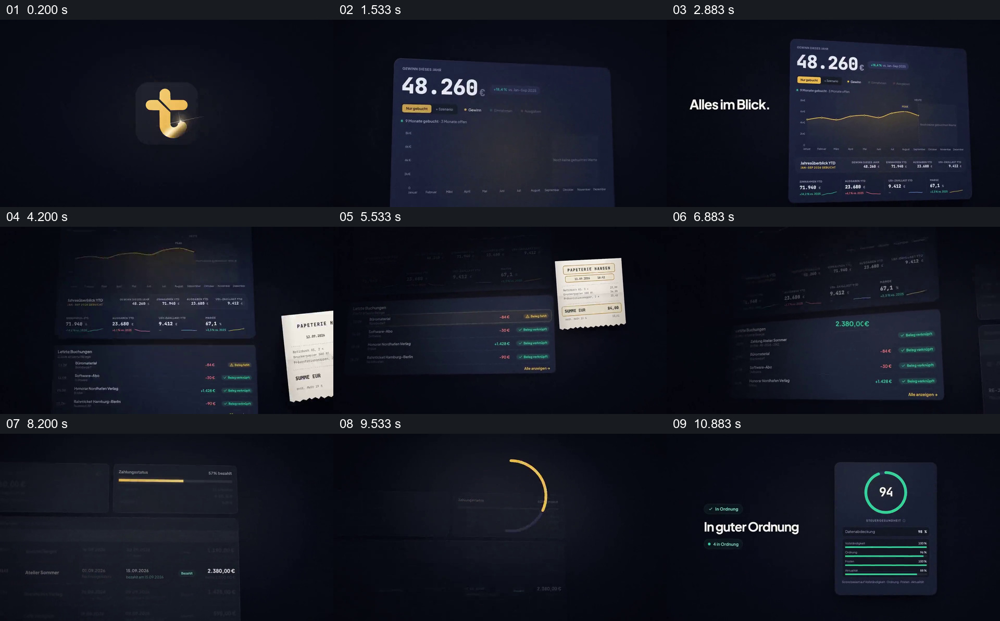

# 从财务总览找到一笔票据，再把明细接到整体状态

- 作品：案例 045《票据、数字与财务界面》（库内索引名）。
- 原片范围：00:00.000–00:12.000，含起点、不含终点；[完整原片](../video.mp4)｜[本卡片段](c01.mp4)，片段起点对应原片 0.000 秒。
- 范围依据：0–12 秒从总览、单据与交易对应延续到付款和综合状态卡，构成一套财务工作空间展示；后续是品牌收尾。
- 观察方式：核看全片 64 帧总览及本卡九宫格；未独立连续原速观看，快速变化和运动节奏待核。未独立听审，声音内容未知。片中事实和演示未独立查证，新题材迁移尚未实测。

## 原画面具体怎样设计

深蓝黑背景中央先建立金色品牌图形，其承载面扩大为略倾斜的深色财务面板。面板顶部显示年度金额 48,260 欧元，黄色折线和下方多项指标逐步显露；旁侧短句 “Alles im Blick.” 留出标题区。

视线随后落到下面的交易列表，原总览仍在上方但变暗。一张浅色纸质收据出现在列表右前方，收据上可辨商户、日期与 84 欧元总额；列表中有对应的 −84 欧元行，以及红绿金额和“凭证已关联”等状态。收据缩小后列表行获得强调，接着另一条收入和付款详情、付款状态横条进入画面。

最后原界面退暗，单独竖卡显示圆形数值 94 与下面若干状态条，左侧短句表示状态良好。数字、凭证与评分均是片中演示，不能据此证明真实交易、自动匹配是否成功或评分的计算依据。

## 为什么这样设计，好在哪里

片段不是只在财务大盘上排列小数字，而是先让人理解它的总览，再把一个具体纸质凭证放到对应的交易行旁：浅色收据与深色列表反差明显，原列表仍可见，有助于理解材料归属。之后付款状态和综合卡把注意力从一笔记录带回更高层的状态。层次切换时保留或压暗已有界面，使不同信息仍像属于同一工作空间，而不是三张无关海报。

必须保留凭证与交易可以核对的关系，以及总览、局部和状态各自的含义；否则只剩“漂亮仪表盘”的外观。圆环、金色线条和倾斜角度可以改变。以上是画面分析，未验证财务数据或观众反应。

## 可直接使用的创意指令

当介绍一套业务系统时，先选择有明确单位和统计范围的总览，建立观众将要查看的工作空间；再选一条具有真实或标明模拟来源的记录，把对应的单据或原始材料放在记录旁，突出能核对身份与金额的关键字段，之后让注意力回到这条记录的处理状态。需要总评分或汇总状态时，给出其来源、范围和算法或明确标为演示，避免将多个不同数据强行讲成因果关系。主色、图表与界面形式可以替换，但总览、单据、记录和状态的对应必须成立。
