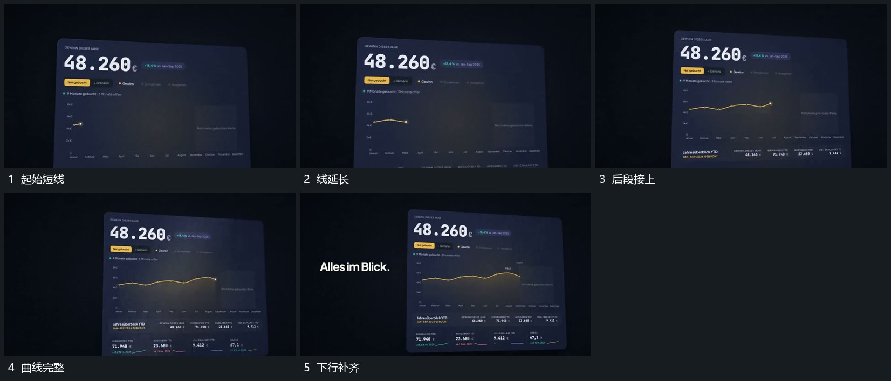

# 曲线从左向右逐段延长，下部短行随后增加

## 运动指令

保留片面，在轨迹区由左向右逐段延长曲线，端点跟随新线移动。曲线已建立部分保持，线到后端后再在下部增加多行短内容，旁侧字组随后接入。

## 视频切片

[播放本机制的原片切片](m02.mp4)

覆盖分镜中“起始短线”至“下行补齐”的连续过程，并保留邻近的前后衔接画面；原片中交叠发生的动作一并保留。

## 分镜过程

## 组合与调整

曲线形状可以替换，沿线增长应清楚，不用整片渐显冒充绘制。
