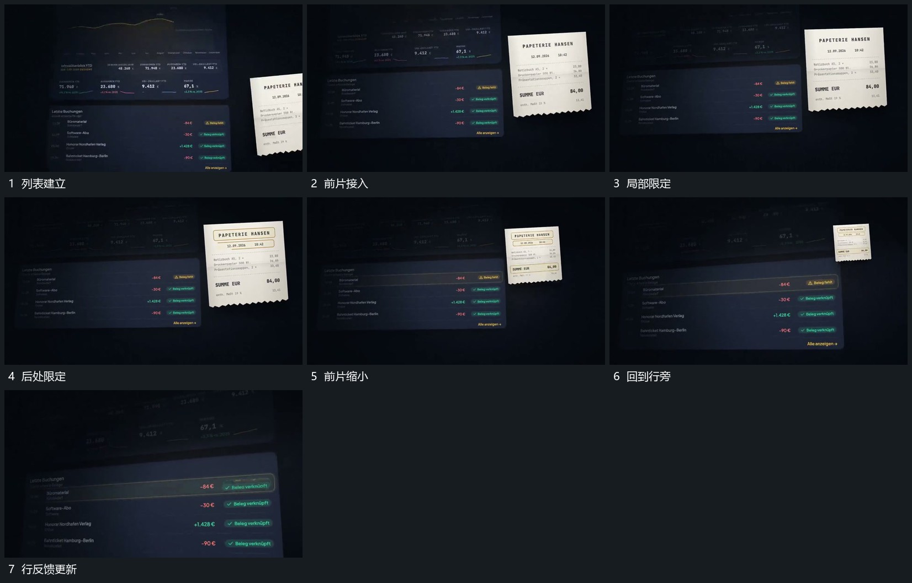

# 前层斜片接入，局部框逐项限定后缩回列表一行

## 运动指令

保留下列表，在其前接入一张倾斜小片。逐项为片内局部补出边界，小片完成后缩小并回到列表对应行旁；行内短反馈随后更换，前片不再占据主要空间。

## 视频切片

[播放本机制的原片切片](m03.mp4)

覆盖分镜中“列表建立”至“行反馈更新”的连续过程，并保留邻近的前后衔接画面；原片中交叠发生的动作一并保留。

## 分镜过程

## 组合与调整

归位终点应明确属于该行。局部框数量可调，避免片缩到无意义空位置。
