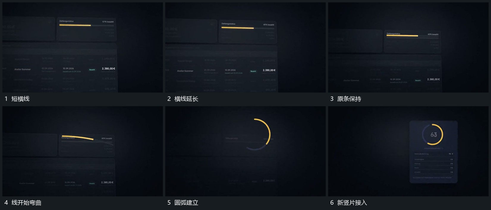

# 横条逐步延长后弯成圆弧，圆弧接管新竖片

## 运动指令

在固定横条内延长短线，达到稳定长度后让线逐渐弯成圆弧。原横条退弱，圆弧保留并接到新竖片上方，成为下一组的持续对象。

## 视频切片

[播放本机制的原片切片](m04.mp4)

覆盖分镜中“短横线”至“新竖片接入”的连续过程，并保留邻近的前后衔接画面；原片中交叠发生的动作一并保留。

## 分镜过程

## 组合与调整

保留同一条线的形态接力，不用横线先切掉、另开圆环替代。
