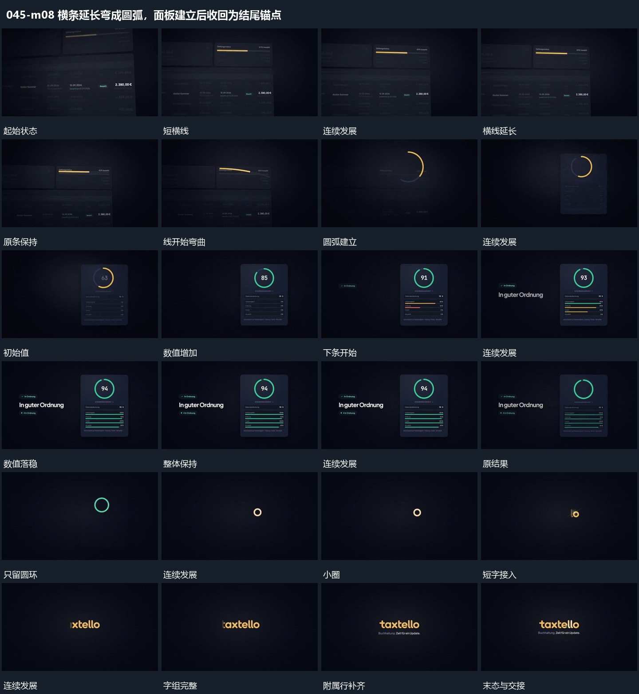

# 横条延长弯成圆弧，面板建立后收回为结尾锚点

## 运动指令

横条从增长转为弯曲圆弧，圆弧接住竖片并更新数值及多行短条；竖片退去后圆环缩小，衔接短字组收尾。

1. **横条逐步延长后弯成圆弧，圆弧接管新竖片**

在固定横条内延长短线，达到稳定长度后让线逐渐弯成圆弧。原横条退弱，圆弧保留并接到新竖片上方，成为下一组的持续对象。

2. **圆弧内数值增加，下部多行短条错峰延长**

让圆弧沿自身方向继续增长，圈内数值增加。竖片下方多行短条错峰延长，早完成行先停住，后行继续，最后数值与所有行共同稳定。

3. **竖片退去，圆环缩回小圈并接入短字组**

先让竖片与内部短行退出，只留圆环。圆环缩回中央小圈，再从小圈所在位置接入短字组，附属行稍后补齐，结尾整体保持。

整段结束：短字组及附属行齐全 保留必要落稳与交接，中间已建立的参照沿用到下一步骤。

## 视频切片

[播放本机制的原片切片](m08.mp4)

保留起始准备、连续发展和完成或明确交接；首尾按本段运动范围裁切，不拼接、不变速。相连的小动作合为同一完整段落。

## 分镜过程

## 组合与调整

横条从增长转为弯曲圆弧，圆弧接住竖片并更新数值及多行短条；竖片退去后圆环缩小，衔接短字组收尾。 复用时可调整元素数量、幅度和相对节奏，保留上述进入、交叠与完成关系；不直接沿用原片题材或时长。

保留同一条线的形态接力，不用横线先切掉、另开圆环替代。

不要求各行同长或同时结束。数值和短条内容由新片确定。

保持小圈与字组的位置联系，收束不要插入无关入场动作。
