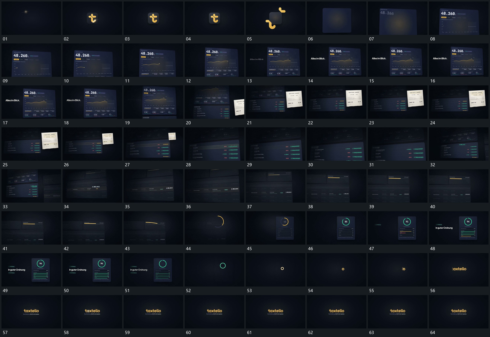

# 045｜原片运动总览

[观看完整原片](video.mp4)

## 运动总览

开头 小形分开外移，承载面扩大后补入内部内容 让中央小形分开移向外围，原承载面扩大为大片，再逐项补入内容。曲线从左向右逐段延长，下部短行随后增加 在固定片内逐段延长曲线，下部短行随后增加。大片上移，把下列表让到中心，前层斜片接入，局部框逐项限定后缩回列表一行 在前层接入倾斜小片，局部框逐项限定后缩回列表一行。

中段选中行退场，新组接入，横条逐步延长后弯成圆弧，圆弧接管新竖片 将稳定横条中的短线逐步延长，再弯成圆弧并接手新竖片。圆弧内数值增加，下部多行短条错峰延长 在圆弧内增加数值，下部多行短条错峰延长，完整后保持。末段 竖片退去，圆环缩回小圈并接入短字组 让原竖片退去，圆环缩回小圈，再由小圈接入短字组与附属行收尾。

## 完整运动段落

以下按原片中的出现顺序引用。建立、内部发展及完成反馈放在同一段中；同时发生的局部动作与运镜写在同一份指令里。不同段之间可以是连续接管，也可以是直接切换，不能仅凭条目相邻认定可直接拼接。重复出现的同类运动采用一次连续代表范围，切片不以逐段无缝覆盖整片为目标。

1. [小形分开让出承载面，曲线与下部短行补齐](mechanisms/m07.md)：中央小形拆分向外，承载面扩大，数值先建立；曲线从左向右延长，下部短行逐项加入完成面板。

2. [前层斜片接入，局部框逐项限定后缩回列表一行](mechanisms/m03.md)：先独立展示，后缩回来源行

3. [横条延长弯成圆弧，面板建立后收回为结尾锚点](mechanisms/m08.md)：横条从增长转为弯曲圆弧，圆弧接住竖片并更新数值及多行短条；竖片退去后圆环缩小，衔接短字组收尾。

切片保留起始准备、必要内部停顿和完成或明确交接；首尾省略无新发展的等待，持续运动不要求人为停住。以上基于真实源帧序列和重点边界核对，不等同于全片连续声画审片。

## 完整64宫格

