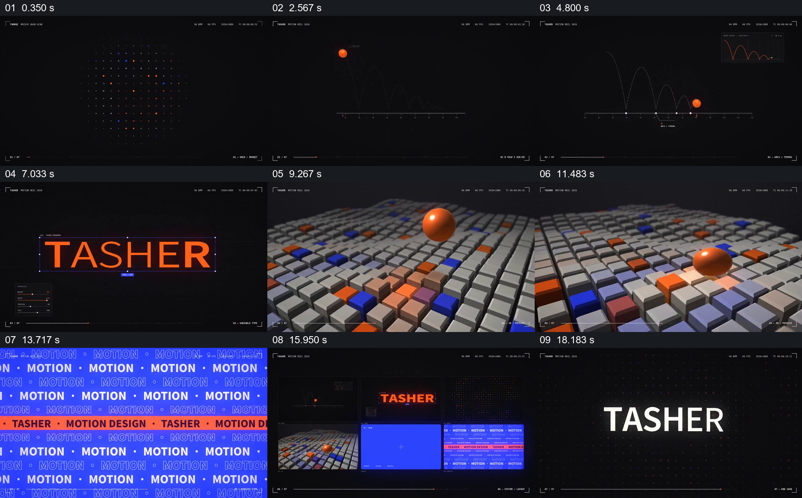

# 用共同视觉元素把不同形式实验汇总为作品展示

- 作品：案例 093《运动设计作品展示》（本次概括）。
- 原片范围：00:00.000–00:20.062，含起点、不含终点；[完整原片](../video.mp4)｜[本卡片段](../video.mp4)。
- 观察方式：依据约每秒一次的真实源帧观察，未连续原速观看或听审；声音、语气与完整播放节奏未确认。

## 原画面具体怎样设计

黑底点阵出现后，橙色球体与曲线图同屏；橙色铺满再转为中央排版的 TASHER 字样。随后球体来到灰色方块网格上，橙色和蓝色方块散布其间；蓝底上重复 MOTION 文字并以橙色条穿过，最后前三类画面缩成并排窗口，回到品牌文字。

## 为什么这样设计，好在哪里

黑、橙、蓝及球体在不同实验中反复出现，给独立画面共同的识别线索；并排窗口使观众把先前的形式归到同一作品集合。抽帧不能确认每个运动的连贯过程。

以上为依据画面的分析，非作者自述；预期观看效果未经观众测试。

## 可直接使用的创意指令

展示多项视觉实验时，选择贯穿各项的少量颜色、对象或版式；每项保留足够时间建立其独特形式，最后并列回看并归入共同身份。具体运动和作品数量按已有真实素材决定。
