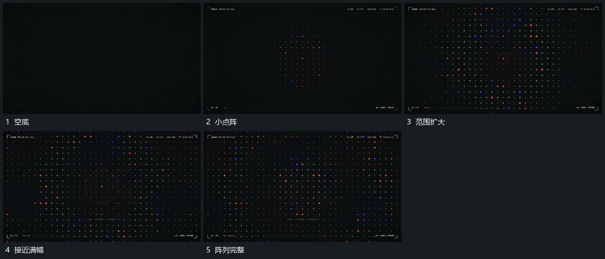

# 小点阵向外展开成满幅排列

## 运动指令

中央先建立少量规则点列，整体向外扩大，并在外缘逐次补入新列，使阵列范围从小到大。部分点在原格位上增强再退弱，格位关系始终保留，最后形成完整密集范围。

## 视频切片

[播放本机制的原片切片](m01.mp4)

覆盖分镜中“空底”至“阵列完整”的连续过程，并保留邻近的前后衔接画面；原片中交叠发生的动作一并保留。

## 分镜过程

## 组合与调整

控制点列数量，格位不随每次闪动随机跳变；可保留局部空处接下一单点。
