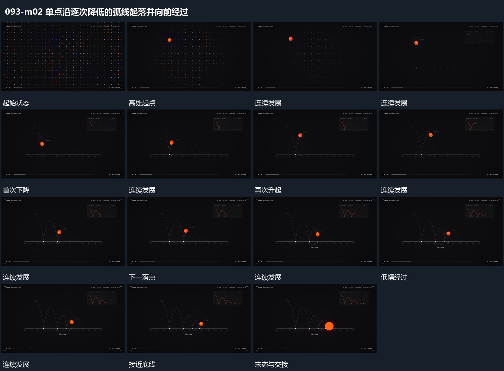

# 单点沿逐次降低的弧线起落并向前经过

## 运动指令

让单点向前经过，同时沿弧线落向底线。每次到达底线后再次升起，但下一弧的高度比上一弧低，前进仍连续。经过处留下浅路径与落点小标，最后把起伏收小到接近底线。

## 视频切片

[播放本机制的原片切片](m02.mp4)

保留起始准备、连续发展和完成或明确交接；首尾按本段运动范围裁切，不拼接、不变速。尾部只保留理解结果所需的展示。

## 分镜过程

## 组合与调整

弧线高度按本片决定，不反推物理系数；每次起落都接上前一落点。
