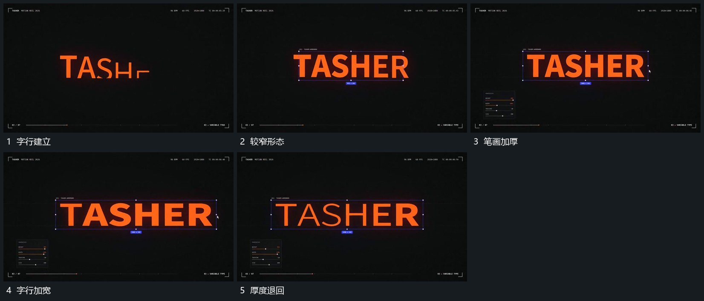

# 固定字框内宽度与笔画厚度连续变化

## 运动指令

保留字框位置和行的整体基线，让字形宽度与笔画厚度连续变化。字的间距随宽度同步调整，边界仍包住同一行；变化到宽形后再收回厚度，不替换成另一行文字。

## 视频切片

[播放本机制的原片切片](m03.mp4)

覆盖分镜中“字行建立”至“厚度退回”的连续过程，并保留邻近的前后衔接画面；原片中交叠发生的动作一并保留。

## 分镜过程

## 组合与调整

适用于支持该变化的字形或几何线组；不要从源片推定字体轴或源码参数。
