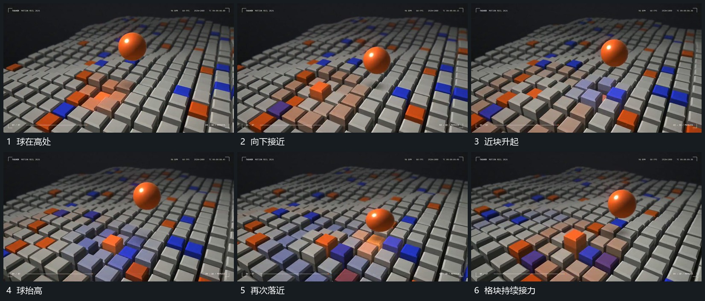

# 球上下起落格块从近落点向外先后升降

## 运动指令

球在格阵上方起落，靠近落点时周边格块先后抬起，稍远格块再接上，形成由近到外的高度变化。球再次升高时近块开始回落，下一轮起落在仍有余动的格阵中接续；取景可少量沿阵列转角。

## 视频切片

[播放本机制的原片切片](m04.mp4)

覆盖分镜中“球在高处”至“格块持续接力”的连续过程，并保留邻近的前后衔接画面；原片中交叠发生的动作一并保留。

## 分镜过程

## 组合与调整

只描述可见交叠，不要求真实碰撞模拟；格块升降有先后，不能整片同幅起伏。
