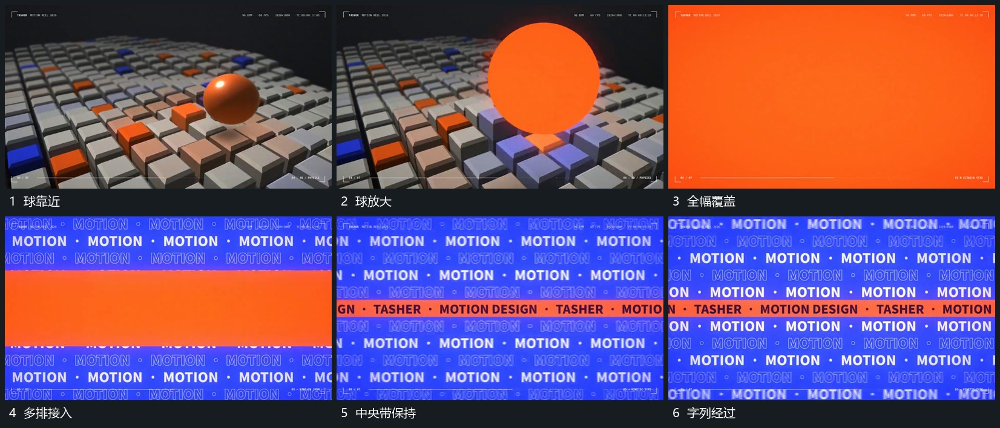

# 球向前放大覆盖后多排字列横向经过

## 运动指令

球向前靠近并放大到越界，覆盖格阵后转入多排字列。各排错开向横向经过，中央长带先保持范围，其内部字行随后接上；外围排继续活动，中央带不随它们漂移。

## 视频切片

[播放本机制的原片切片](m05.mp4)

覆盖分镜中“球靠近”至“字列经过”的连续过程，并保留邻近的前后衔接画面；原片中交叠发生的动作一并保留。

## 分镜过程

## 组合与调整

多排可用图块替换；覆盖接管保持中心，不用空帧断开两个阶段。
