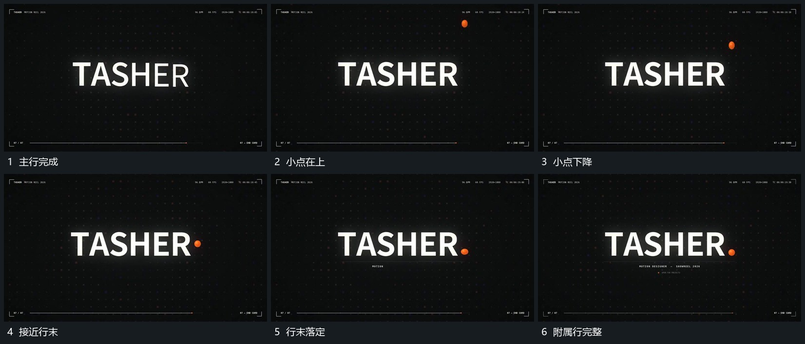

# 上方小点落到主行末端附属行再补齐

## 运动指令

主行完成后让小点从上方落向行末，下降中带少量横向位移，最终停在末字旁。主行保持，附属小行在点落定后分段补齐；外围点阵退弱，中央整组留下。

## 视频切片

[播放本机制的原片切片](m07.mp4)

覆盖分镜中“主行完成”至“附属行完整”的连续过程，并保留邻近的前后衔接画面；原片中交叠发生的动作一并保留。

## 分镜过程

## 组合与调整

落点可换任意局部；小点应从可见上方接近，不在行末凭空出现。
