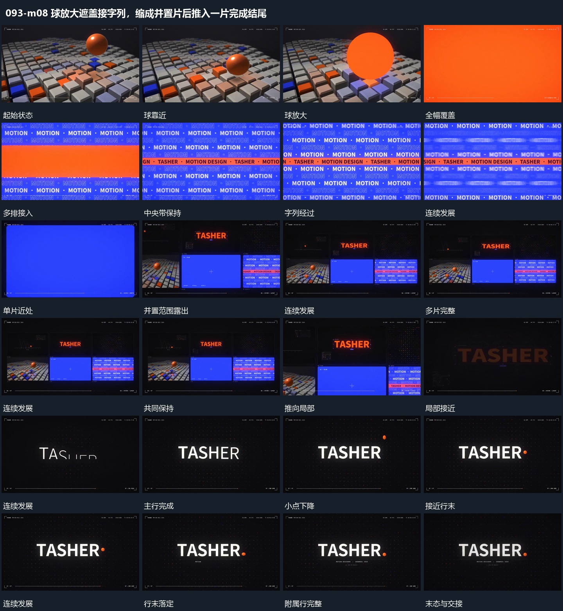

# 球放大遮盖接字列，缩成并置片后推入一片完成结尾

## 运动指令

球向前放大覆盖后多排字列横向经过；活动片面缩回并置全景，再推近选片，末端小点落入并补齐附属行。

1. **球向前放大覆盖后多排字列横向经过**

球向前靠近并放大到越界，覆盖格阵后转入多排字列。各排错开向横向经过，中央长带先保持范围，其内部字行随后接上；外围排继续活动，中央带不随它们漂移。

2. **活动片面缩回形成并置全貌再推向一片**

从活动片面退镜，露出周围其他片面，各片内部继续自己的运动。多片全貌稳定后选择其中一片靠近，其他片沿边缘越界，选中片内部保持连续；到近处后接新的主行。

3. **上方小点落到主行末端附属行再补齐**

主行完成后让小点从上方落向行末，下降中带少量横向位移，最终停在末字旁。主行保持，附属小行在点落定后分段补齐；外围点阵退弱，中央整组留下。

整段结束：小点在行末主行下方齐全 保留必要落稳与交接，中间已建立的参照沿用到下一步骤。

## 视频切片

[播放本机制的原片切片](m08.mp4)

保留起始准备、连续发展和完成或明确交接；首尾按本段运动范围裁切，不拼接、不变速。相连的小动作合为同一完整段落。

## 分镜过程

## 组合与调整

球向前放大覆盖后多排字列横向经过；活动片面缩回并置全景，再推近选片，末端小点落入并补齐附属行。 复用时可调整元素数量、幅度和相对节奏，保留上述进入、交叠与完成关系；不直接沿用原片题材或时长。

多排可用图块替换；覆盖接管保持中心，不用空帧断开两个阶段。

避免为退镜另做静态缩略图；保留片内运动与来源位置才能形成真实接续。

落点可换任意局部；小点应从可见上方接近，不在行末凭空出现。
