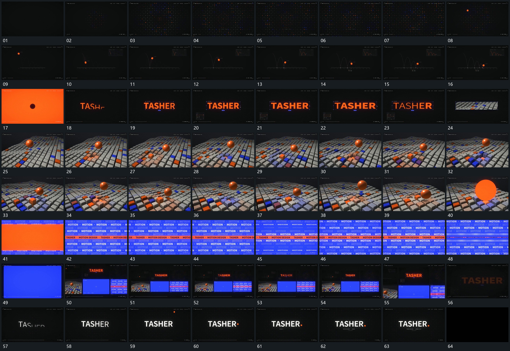

# 093｜原片运动总览

[观看完整原片](video.mp4)

## 运动总览

全片先用小点阵向外展开成满幅排列让中央点阵由小到大展开，随后单点沿逐次降低的弧线起落并向前经过把单点沿逐次变低的弧线送向底线。接到文字后，固定字框内宽度与笔画厚度连续变化在固定框内连续改变字形宽度与笔画厚度。

转入纵深格阵时，球上下起落格块从近落点向外先后升降让球起落与落点周边格块的先后升降交叠；球向前放大覆盖后多排字列横向经过把球放大覆盖并接到多排字列经过。之后活动片面缩回形成并置全貌再推向一片缩回多个片面形成并置全貌，再推向局部。结尾复用固定字框内宽度与笔画厚度连续变化建立主行，上方小点落到主行末端附属行再补齐让上方小点落到行末，附属行随后补齐。

## 完整运动段落

以下按原片中的出现顺序引用。建立、内部发展及完成反馈放在同一段中；同时发生的局部动作与运镜写在同一份指令里。不同段之间可以是连续接管，也可以是直接切换，不能仅凭条目相邻认定可直接拼接。重复出现的同类运动采用一次连续代表范围，切片不以逐段无缝覆盖整片为目标。

1. [小点阵向外展开成满幅排列](mechanisms/m01.md)：整体扩张点列持续补入

2. [单点沿逐次降低的弧线起落并向前经过](mechanisms/m02.md)：前进与起落衰减

3. [固定字框内宽度与笔画厚度连续变化](mechanisms/m03.md)：局部宽厚连续变化

4. [球上下起落格块从近落点向外先后升降](mechanisms/m04.md)：起落与局部升降交叠

5. [球放大遮盖接字列，缩成并置片后推入一片完成结尾](mechanisms/m08.md)：球向前放大覆盖后多排字列横向经过；活动片面缩回并置全景，再推近选片，末端小点落入并补齐附属行。

切片保留起始准备、必要内部停顿和完成或明确交接；首尾省略无新发展的等待，持续运动不要求人为停住。以上基于真实源帧序列和重点边界核对，不等同于全片连续声画审片。

## 完整64宫格

