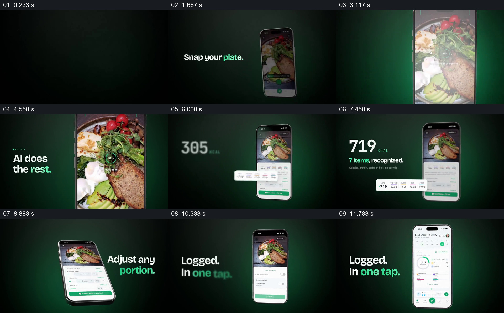

# 让同一餐盘从拍照进入识别、调整和日记

- 作品：案例 043《食物图片与健康应用》（库内索引名）。
- 原片范围：00:00.000–00:12.200，含起点、不含终点；[完整原片](../video.mp4)｜[本卡片段](c01-20261111.mp4)，片段起点对应原片 0.000 秒。
- 范围依据：从拍摄提示和手机建立到保存后的日记概览；约 12.2 秒开始另一项食谱浏览。
- 观察方式：核看全片 64 帧总览及本卡九宫格，并核看各交界附近每 0.2 秒源帧；未独立连续原速观看，快速变化和运动节奏待核。原片无音轨。片中事实和演示未独立查证，新题材迁移尚未实测。

## 原画面具体怎样设计

深绿背景上先出现 “Snap your plate.”，手机从画面一侧进入，屏幕里是一份包含面包、鸡蛋和蔬菜的餐盘。手机局部被放大，餐盘占据右侧大部分面积，旁边出现 “AI does the rest.”；餐盘上有圆形进度和分析提示。

手机缩回后，仍是同一张餐盘图片，下方出现识别项目与营养信息；左侧的大热量数字变化并最终显示 719 kcal、7 items，手机内的营养摘要被单独放大到外侧。之后设备倾斜，屏内可见各项分量和调整控件，旁边写 “Adjust any portion.”；再回到竖直手机与 “Logged. In one tap.”，最后显示每日概览。图片和数值来自片中产品演示，不能据此验证真实识别、热量或保存成功。

## 为什么这样设计，好在哪里

餐盘在拍摄、结果和调整页面持续出现，即使注意力从食物转向数字，观众也能认出数字对应哪个输入。把小小的营养摘要临时放到手机外，再回到包含原始图片与明细的界面，既强调结果又保留来源；调整步骤让结果不是一出现便无条件定稿，日记页面则提供记录动作的可见出口。若把食物图与结果分离成无关示意，过程会难以跟踪；若只显示结果数字，则丢掉用户如何校对并保存的环节。以上为对画面的分析，实际效果与识别准确性未验证。

## 完整照排指令

以[完整原片](../video.mp4)的 0–12.2 秒为准。画幅 1280×720，源帧率 60/1。以下拍点为抽帧定位，位置按画幅百分比取近似值。

### 用料

【餐盘原图】【识别项组】【调整字段】【餐食日记】使用同一餐食，保留照片和分项一一对应。备【拍摄短句】【识别短句】【识别读数】【记录短句】【收束短句】。实际营养值注明份量、估算方法及可核对出处。

### 按源时刻摆放

1. **0–约 3 秒。** 深绿近黑渐变，左侧白粗【拍摄短句】，末词青绿。细黑手机从右转入，屏内【餐盘原图】满占上半，放大推进至餐盘仍可辨。
2. **约 3–6 秒。** 手机回到右半，左侧白绿【识别短句】与粗白【识别读数】依次显，右边沿同一餐盘叠浅白识别栏，生成【识别项组】。先图后条目，数变化须对应实际状态。
3. **约 6–9 秒。** 手机转成靠下的斜放白屏，图在上、【调整字段】在下，底端长青绿钮。继续使用同一餐图，调整结果保留原条目坐标。可用静态同源截图分层，不循环确认动作。
4. **约 9–12.200 秒。** 手机直立，左侧白绿【记录短句】。其内先为餐食详情，再切成白底【餐食日记】的小缩略图列表。最后手机移左，右侧粗【收束短句】白绿分色，保持至 12.200 秒切出。

### 局部采用

仅配对照片与识别可取约 0–6 秒；完整调整和日记需要相同的已记录餐食。

### 验证状态

已对照逐秒原片画序并读回，核对相同餐盘、识别栏、调整与日记接续。数值小字、精确切帧和换料试摆待核。
