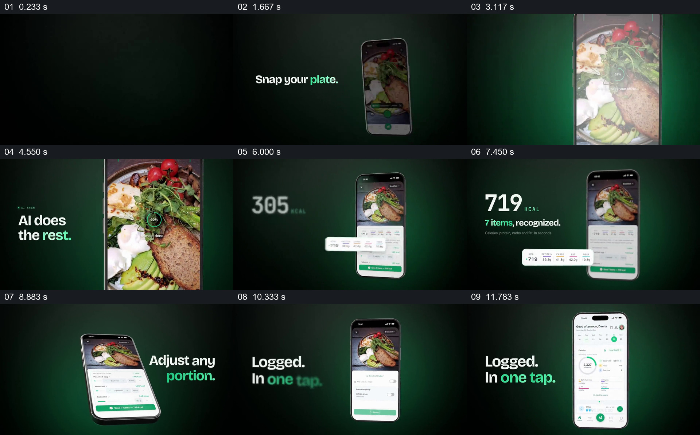

# 让同一餐盘从拍照进入识别、调整和日记

- 作品：案例 043《食物图片与健康应用》（库内索引名）。
- 原片范围：00:00.000–00:12.200，含起点、不含终点；[完整原片](../video.mp4)｜[本卡片段](c01-20261111.mp4)，片段起点对应原片 0.000 秒。
- 范围依据：从拍摄提示和手机建立到保存后的日记概览；约 12.2 秒开始另一项食谱浏览。
- 观察方式：核看全片 64 帧总览及本卡九宫格，并核看各交界附近每 0.2 秒源帧；未独立连续原速观看，快速变化和运动节奏待核。原片无音轨。片中事实和演示未独立查证，新题材迁移尚未实测。

## 原画面具体怎样设计

深绿背景上先出现 “Snap your plate.”，手机从画面一侧进入，屏幕里是一份包含面包、鸡蛋和蔬菜的餐盘。手机局部被放大，餐盘占据右侧大部分面积，旁边出现 “AI does the rest.”；餐盘上有圆形进度和分析提示。

手机缩回后，仍是同一张餐盘图片，下方出现识别项目与营养信息；左侧的大热量数字变化并最终显示 719 kcal、7 items，手机内的营养摘要被单独放大到外侧。之后设备倾斜，屏内可见各项分量和调整控件，旁边写 “Adjust any portion.”；再回到竖直手机与 “Logged. In one tap.”，最后显示每日概览。图片和数值来自片中产品演示，不能据此验证真实识别、热量或保存成功。

## 为什么这样设计，好在哪里

餐盘在拍摄、结果和调整页面持续出现，即使注意力从食物转向数字，观众也能认出数字对应哪个输入。把小小的营养摘要临时放到手机外，再回到包含原始图片与明细的界面，既强调结果又保留来源；调整步骤让结果不是一出现便无条件定稿，日记页面则提供记录动作的可见出口。若把食物图与结果分离成无关示意，过程会难以跟踪；若只显示结果数字，则丢掉用户如何校对并保存的环节。以上为对画面的分析，实际效果与识别准确性未验证。

## 可直接使用的创意指令

展示图片转记录时，选择一份有授权、能辨认的原始图片，以及与其对应且可核对的结果。先让图片成为手机或界面里的明确输入；在处理和结果阶段保留该图片，将最重要的输出从拥挤界面中提出到足够可读的位置，再回到原界面显示用户可以检查、修订和保存的位置。保存后给出同一条记录的结果页。主体、设备与摘要形式可调整，但不能把生成的演示数字当作实测值；食物份量和营养信息应标明估算依据并依实际用途核对。
