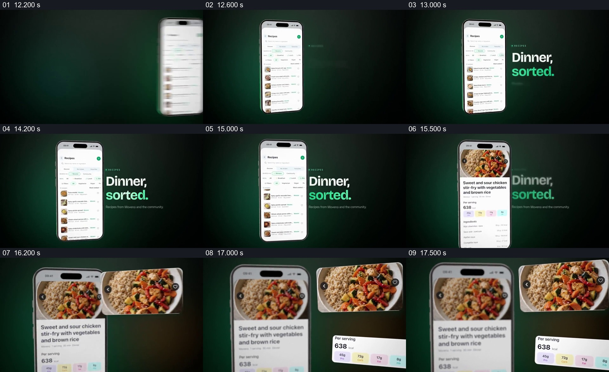

# 把食谱页里的菜品与每份信息提出到手机旁

- 作品：案例 043《食物图片与健康应用》（库内索引名）。
- 原片范围：00:12.200–00:17.800，含起点、不含终点；[完整原片](../video.mp4)｜[本卡片段](c02-20261111.mp4)，片段起点对应原片 12.200 秒。
- 范围依据：从食谱列表接管手机开始，到菜品图及每份信息在手机旁充分显露；之后换入饮水页面。
- 观察方式：核看全片 64 帧总览及本卡九宫格，并核看各交界附近每 0.2 秒源帧；未独立连续原速观看，快速变化和运动节奏待核。原片无音轨。片中事实和演示未独立查证，新题材迁移尚未实测。

## 原画面具体怎样设计

深绿背景上手机停在左侧，屏内为带缩略图的食谱列表，右侧大字 “Dinner, sorted.”。在不同抽样状态里列表内容向上变化，随后手机页面由列表进入一份鸡肉蔬菜米饭的详情，顶部是菜品照片，下方是菜名和每份数据。

镜头式放大后的手机留在左侧，画面右上出现同一菜品的横向图片，右下再出现写有每份 638 kcal 和若干营养项目的小白卡；手机内仍能看到原来的照片和文字，但相对弱化。右侧两个浮片分开占据各自空间，下一段再换成饮水概览。

## 为什么这样设计，好在哪里

先看到列表，观众知道这不是一张孤立的餐食海报；切入详情后，再把原本挤在小手机中的图片和数字分别外提，便于看清食物与每份信息，同时来源页面留在旁边。照片与数据是同一个具体条目的不同侧面，而不是两个无关插图。缺少列表和详情的关系，就少了从“选择”到“看清”的过程；缺少来源页面，外侧数据容易失去归属。以上为画面分析，不代表营养数据和应用功能已核实。

## 可直接使用的创意指令

当要介绍某个列表中的具体项目时，先展示能辨认该项目所在位置的真实列表，进入对应详情后，保留来源界面一侧，将最有意义的图像及关键摘要分别放大到另一侧。图片、名称与数据必须对应同一条记录，外提区域给数据留下可读空间，完成强调后再衔接下一个任务。窗口位置、数量、构图与题材可自由调整；营养等专业数据要有可靠来源和单位，示意图不能宣称数据已经验证。
