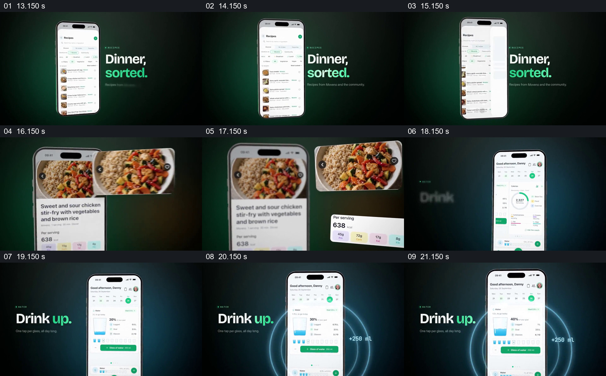

# 将餐食选择和饮水记录落在具体界面

- 作品：案例 043《饮食与训练记录》（索引名称）。
- 原片范围：00:13.000–00:22.000，含起点、不含终点；[完整原片](../video.mp4)｜[本卡片段](c02.mp4)。
- 观察方式：依据整片 64 宫格和约每秒一次的真实源帧观察，未连续原速观看；原片无音轨，完整播放节奏未确认。

## 原画面具体怎样设计

手机列出餐食，页面放大一份鸡肉米饭图片及每份数据；随后切回手机概览，“Drink up.”旁显示水量图与增加 250 ml 的标记。

## 为什么这样设计，好在哪里

菜品图和每份信息共同指向食物本身，水量数字给饮水动作明确对象。示例数值和产品功能未核实。

以上为依据画面的分析，非作者自述；预期观看效果未经观众测试。

## 可直接使用的创意指令

演示日常记录时，选择真实或标注为模拟的餐食和饮水数据，给出每份信息及单位，并展示用户操作后的具体状态；目标和推荐应根据实际情况确定。
