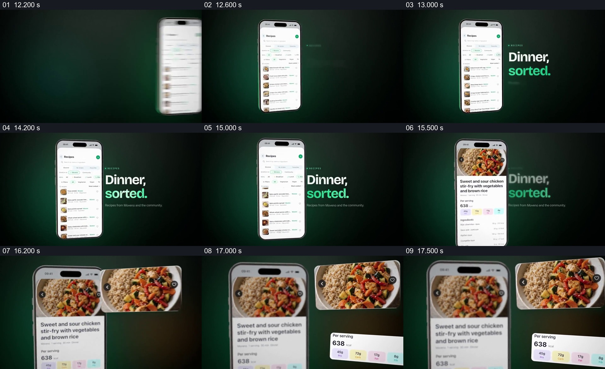

# 把食谱页里的菜品与每份信息提出到手机旁

- 作品：案例 043《食物图片与健康应用》（库内索引名）。
- 原片范围：00:12.200–00:17.800，含起点、不含终点；[完整原片](../video.mp4)｜[本卡片段](c02-20261111.mp4)，片段起点对应原片 12.200 秒。
- 范围依据：从食谱列表接管手机开始，到菜品图及每份信息在手机旁充分显露；之后换入饮水页面。
- 观察方式：核看全片 64 帧总览及本卡九宫格，并核看各交界附近每 0.2 秒源帧；未独立连续原速观看，快速变化和运动节奏待核。原片无音轨。片中事实和演示未独立查证，新题材迁移尚未实测。

## 原画面具体怎样设计

深绿背景上手机停在左侧，屏内为带缩略图的食谱列表，右侧大字 “Dinner, sorted.”。在不同抽样状态里列表内容向上变化，随后手机页面由列表进入一份鸡肉蔬菜米饭的详情，顶部是菜品照片，下方是菜名和每份数据。

镜头式放大后的手机留在左侧，画面右上出现同一菜品的横向图片，右下再出现写有每份 638 kcal 和若干营养项目的小白卡；手机内仍能看到原来的照片和文字，但相对弱化。右侧两个浮片分开占据各自空间，下一段再换成饮水概览。

## 为什么这样设计，好在哪里

先看到列表，观众知道这不是一张孤立的餐食海报；切入详情后，再把原本挤在小手机中的图片和数字分别外提，便于看清食物与每份信息，同时来源页面留在旁边。照片与数据是同一个具体条目的不同侧面，而不是两个无关插图。缺少列表和详情的关系，就少了从“选择”到“看清”的过程；缺少来源页面，外侧数据容易失去归属。以上为画面分析，不代表营养数据和应用功能已核实。

## 完整照排指令

以[完整原片](../video.mp4)的 12.2–17.8 秒为准。画幅 1280×720，源帧率 60/1。以下拍点为抽帧定位，位置按画幅百分比取近似值。

### 用料

【食谱列表】【食谱详情】【菜品头图】【每份营养卡】取同一道菜，并保留列表项、详情图和份量的对应关系。备【餐食短句】【食谱名称】【每份读数】【数据单位】【邻段短句】【邻段手机页】。实际营养值附可打开的配方或计算依据，记录每份重量和估算口径。

### 按源时刻摆放

1. **12.200–约 13.700 秒。** 近黑绿色渐变，中央偏左竖手机内显示亮白【食谱列表】，食谱缩图在左，短文字在右。手机右侧用白与青绿两行粗体排【餐食短句】。留住选中条目，下一镜详情开在同一手机内。
2. **约 13.700–15.500 秒。** 手机靠中立稳，白【食谱详情】上半铺【菜品头图】，其下以较粗黑字排【食谱名称】，低位保留浅色指标。将同一头图的副本提出到手机右上，手机内原图短留。再将【每份营养卡】从详情下部提出至右下，白卡上排深色【每份读数】，辅以小【数据单位】和不同色的短标。两张提出卡彼此有缝，保留原图边缘和手机外框。静态截图可分层平移，避免用另一道菜或另一份量充当对应内容。
3. **约 15.500–17.800 秒。** 旧绿底与浮卡退场，略冷的青蓝光扫入。中右新竖页【邻段手机页】进入，左侧白青【邻段短句】保持两色，至 17.800 秒切出。只用食谱详情时，在冷色新页接管前切。

### 局部采用

只有配对的食谱图片及每份数据，可单用约 13.700–15.500 秒的详情与浮卡。若缺可靠数据，仅提出同一道菜的图片。

### 验证状态

已对照逐秒原片画序并读回，核对白色列表、详情头图及图卡提出，和冷色邻段切入。浮卡精确帧、营养小字与换料试摆待核。
