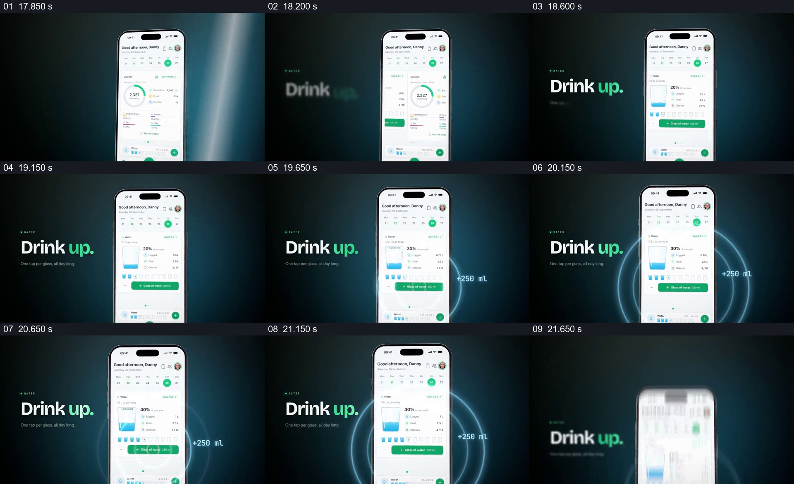

# 在固定饮水页面旁显出单次增量，让总量在屏内累积

- 作品：案例 043《食物图片与健康应用》（库内索引名）。
- 原片范围：00:17.800–00:21.800，含起点、不含终点；[完整原片](../video.mp4)｜[本卡片段](c03-20261111.mp4)，片段起点对应原片 17.800 秒。
- 范围依据：从食谱结果切入饮水总览，到 250 ml 的增量及新水量状态可见；随后旧设备退场、训练页接入。
- 观察方式：核看全片 64 帧总览及本卡九宫格，并核看各交界附近每 0.2 秒源帧；未独立连续原速观看，快速变化和运动节奏待核。原片无音轨。片中事实和演示未独立查证，新题材迁移尚未实测。

## 原画面具体怎样设计

由食谱详情换到手机每日概览，画面左侧出现 “Drink up.”，手机里有饮水目标、水杯图、百分比、小杯格与加水按钮。接着屏内饮水卡占据主要位置；抽样画面显示比例从 20% 变为 30%、40%，小杯格和杯中蓝色水量也相应增加。

手机右外侧出现 “+250 ml”，设备周围有蓝色同心圆提示；左侧短句仍留在深色背景中。最后数字和水杯状态留在手机内，手机开始离开，为下一段训练页面让位。抽帧能说明状态先后，但不足以核定圆环与数值的逐帧同步关系；水量与目标只是片中示意。

## 为什么这样设计，好在哪里

固定手机与短句作为参照，让变化集中在一次可理解的“加水”上：外侧增量告诉观众这次增加多少，屏内杯数、水位和百分比提供操作之后留下的状态。没有累计结果，外部的 +250 ml 只是一个短暂装饰；没有单次增量，累计数字的变化也不易解释。环形提示和蓝色属于本片包装，单次操作与新状态的对应关系才是可迁移的核心。这里是视觉分析，未验证实际记录结果。

## 完整照排指令

以[完整原片](../video.mp4)的 17.8–21.8 秒为准。画幅 1280×720，源帧率 60/1。以下拍点为抽帧定位，位置按画幅百分比取近似值。

### 用料

【饮水初态】【饮水更新态】取同一账号、日期和目标的页面。准备【单次增量】【目标总量】【累计总量】【计量单位】【饮水短句】【饮水小注】【邻段训练页】【邻段标题】。备可回查的变化前后记录，核对单位、加量及比例。

### 按源时刻摆放

1. **17.800–约 19.000 秒。** 近黑青蓝渐变。竖手机放中轴偏右，占画宽约三成，边缘细暗而屏幕明白。内页为【饮水初态】，保留圆读数、浅蓝水量及绿按钮。左侧 x9% 附粗白和青绿双色【饮水短句】，下接弱亮【饮水小注】。手机和标题不换位置。
2. **约 19.000–21.300 秒。** 手机外右侧用薄浅蓝字显示加号、【单次增量】和【计量单位】，位置靠近中下部。青蓝细同心弧从手机后方偏下扩张，覆盖少量后景，手机框压在弧前。屏内只更新同一水量组件为【饮水更新态】，含【累计总量】及对【目标总量】的占比。先让增量可见，再读到累计结果。手机和左字持续至此段退出。可用同源截屏分层，弧只扩一次，禁止循环重复加量。
3. **约 21.300–21.800 秒。** 弧线和饮水页退，深绿照度上升，右侧手机进入【邻段训练页】，左侧换白绿【邻段标题】。按 21.800 秒切出，可在训练页接管前独立结束。

### 局部采用

仅有一次真实增量和同页前后图，可取 17.800–约 21.300 秒。若缺累计结果，仅呈现增量提示，不能声称已累积。

### 验证状态

已对照每秒两帧原片画序并读回，核对固定手机与左字、右侧加量、弧线在手机后及训练页换入。精确状态帧、屏内原值和换料待核。
