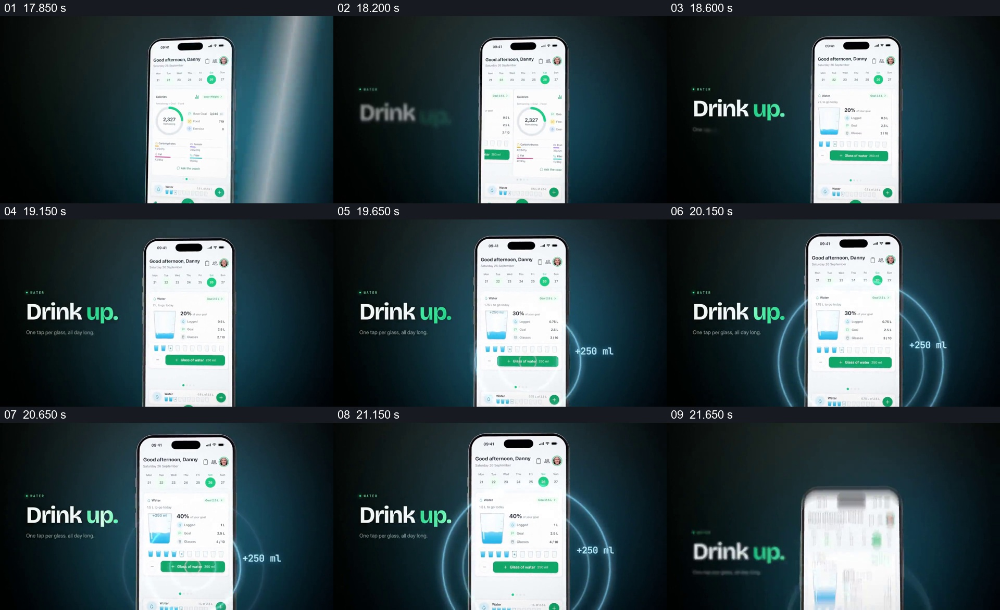

# 在固定饮水页面旁显出单次增量，让总量在屏内累积

- 作品：案例 043《食物图片与健康应用》（库内索引名）。
- 原片范围：00:17.800–00:21.800，含起点、不含终点；[完整原片](../video.mp4)｜[本卡片段](c03-20261111.mp4)，片段起点对应原片 17.800 秒。
- 范围依据：从食谱结果切入饮水总览，到 250 ml 的增量及新水量状态可见；随后旧设备退场、训练页接入。
- 观察方式：核看全片 64 帧总览及本卡九宫格，并核看各交界附近每 0.2 秒源帧；未独立连续原速观看，快速变化和运动节奏待核。原片无音轨。片中事实和演示未独立查证，新题材迁移尚未实测。

## 原画面具体怎样设计

由食谱详情换到手机每日概览，画面左侧出现 “Drink up.”，手机里有饮水目标、水杯图、百分比、小杯格与加水按钮。接着屏内饮水卡占据主要位置；抽样画面显示比例从 20% 变为 30%、40%，小杯格和杯中蓝色水量也相应增加。

手机右外侧出现 “+250 ml”，设备周围有蓝色同心圆提示；左侧短句仍留在深色背景中。最后数字和水杯状态留在手机内，手机开始离开，为下一段训练页面让位。抽帧能说明状态先后，但不足以核定圆环与数值的逐帧同步关系；水量与目标只是片中示意。

## 为什么这样设计，好在哪里

固定手机与短句作为参照，让变化集中在一次可理解的“加水”上：外侧增量告诉观众这次增加多少，屏内杯数、水位和百分比提供操作之后留下的状态。没有累计结果，外部的 +250 ml 只是一个短暂装饰；没有单次增量，累计数字的变化也不易解释。环形提示和蓝色属于本片包装，单次操作与新状态的对应关系才是可迁移的核心。这里是视觉分析，未验证实际记录结果。

## 可直接使用的创意指令

展示一项反复记录的增量时，先给出清楚的初始累计值、单位与目标或范围；安排一个具体操作，并把本次增加或减少量放在容易看见的位置。保持同一对象或界面作为参照，让操作后的总值和进度留在界面里，必要时补充可读的视觉反馈。颜色、容器、是否使用光环及操作次数由项目选择；增量、累计和目标必须使用同一口径，健康相关目标不能直接照搬示意数值。
