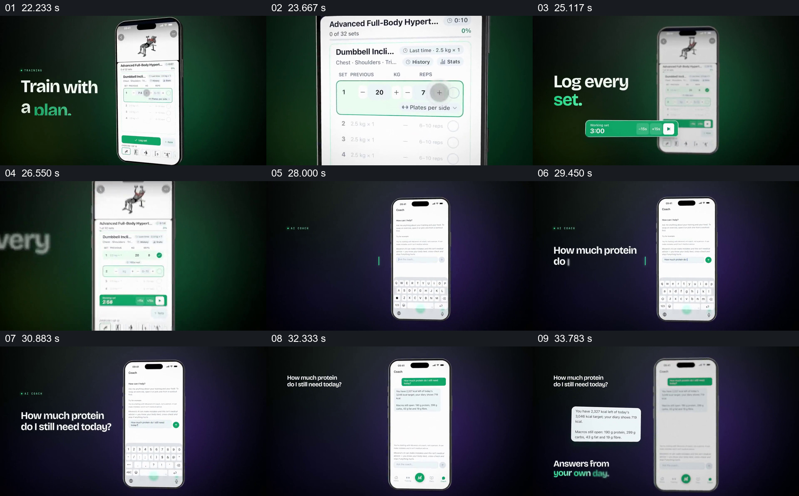

# 把训练记录与基于当天数据的提问分开展示

- 作品：案例 043《饮食与训练记录》（索引名称）。
- 原片范围：00:22.000–00:35.000，含起点、不含终点；[完整原片](../video.mp4)｜[本卡片段](c03.mp4)。
- 观察方式：依据整片 64 宫格和约每秒一次的真实源帧观察，未连续原速观看；原片无音轨，完整播放节奏未确认。

## 原画面具体怎样设计

手机显示训练动作及记录页面，绿色计时条旁写“Log every set.”；接着打开问答输入，画面写“今天还需要多少蛋白质”，回答卡浮在手机旁，底部提示基于当天记录回答。

## 为什么这样设计，好在哪里

训练和问答各有具体页面与操作对象，后者把回答与当日数据联系起来。未核实答案质量或医疗适用性。

以上为依据画面的分析，非作者自述；预期观看效果未经观众测试。

## 可直接使用的创意指令

展示记录与问答时，分别提供真实操作和响应，明确回答使用的数据及缺失项；营养或训练建议需核验来源与适用性，演示不能代替个人专业建议。
