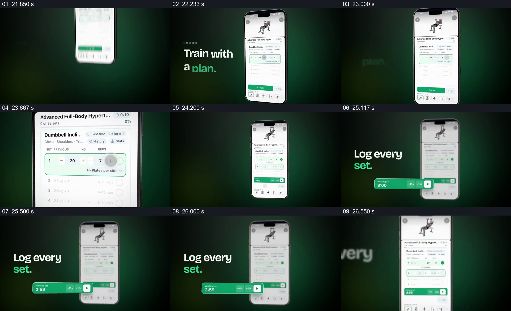

# 从训练计划推进到一组记录与计时反馈

- 作品：案例 043《食物图片与健康应用》（库内索引名）。
- 原片范围：00:21.800–00:26.800，含起点、不含终点；[完整原片](../video.mp4)｜[本卡片段](c04-20261111.mp4)，片段起点对应原片 21.800 秒。
- 范围依据：从饮水页退出、训练页落入开始，到一组记录和计时状态出现；之后转为教练问答。
- 观察方式：核看全片 64 帧总览及本卡九宫格，并核看各交界附近每 0.2 秒源帧；未独立连续原速观看，快速变化和运动节奏待核。原片无音轨。片中事实和演示未独立查证，新题材迁移尚未实测。

## 原画面具体怎样设计

旧手机向上离开后，新的手机显示训练动作示意、计划名称及多组列表，画面左侧写 “Train with a plan.”。画面靠近屏幕，使其中一行的重量、次数与加减控件可见；随后手机退回到一侧，左侧改为 “Log every set.”。

一条绿色计时控件从手机页面所示位置扩展到设备外，出现 3:00 和调整按钮，后续状态显示倒计时变化；手机中的一组训练出现完成标记，下面保留接下来的组。演示中的重量、次数、动作和时间都是界面示例，不能证明实际训练过程。

## 为什么这样设计，好在哪里

全页先告诉观众这是哪项训练，随后只放大一行，让密集列表中的具体操作有了可读对象；当手机回到较小尺度时，计时条独立伸到外侧，后续反馈仍足够醒目。一次设置、完成标记和计时形成连续的可见状态，而不是只展示泛泛的健身界面。需要保留的是同一组记录与反馈的关联，手机、计时条外观和绿色并非必需。上述是设计分析，未验证产品或训练效果。

## 完整照排指令

以[完整原片](../video.mp4)的 21.8–26.8 秒为准。画幅 1280×720，源帧率 60/1。以下拍点为抽帧定位，位置按画幅百分比取近似值。

### 用料

【训练计划页】【单组记录页】【计时状态页】取同一训练和动作。备【计划短句】【记录短句】【动作名】【重量值】【次数值】【计时读数】【计时控件】。实录数据须可核对来源和单位，避免把演示数字当作建议。

### 按源时刻摆放

1. **21.800–约 23.000 秒。** 深黑绿渐变，左侧偏中用粗白【计划短句】，末词亮绿。右边立亮白竖手机，内置【训练计划页】，上方灰调动作小图，中间细项目，中下绿控件。左右区相互留黑。
2. **约 23.000–24.400 秒。** 同一手机推进，画边先裁去壳外，中央放大【单组记录页】，黑字【动作名】及浅绿框内的【重量值】【次数值】同时可读。圆确认位保持在当前行。随后手机缩回右栏，左侧接两行白绿【记录短句】。版本必须回指同一动作、组次与计划。
3. **约 24.400–26.800 秒。** 【计时状态页】保持在同一右窗，底部细绿条从屏内向画心提出，成为横跨手机与左侧间隙的窄亮条。左端用小白【计时读数】，右侧有较亮方形【计时控件】，其余按钮低亮。计时从浮条建立持续到它和手机将退场，须保留已记录的组次，禁止循环重新计时。可用同源静态界面和实际时钟叠字。约 26.500 秒后手机再推进，左字开始走出，按 26.800 秒切。

### 局部采用

有可核对的单组记录与计时，可用约 23–26.800 秒。仅介绍计划可取 21.800–约 23 秒，并按字量保留读停。

### 验证状态

已对照每秒两帧原片画序并读回，核对计划区、同页记录放大及计时条跨到屏外。重量与次数原值、精确切帧和换料待核。
