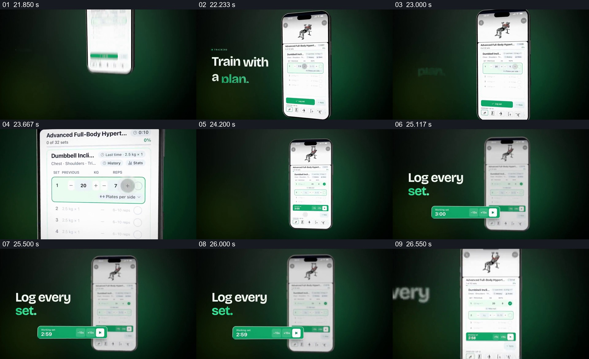

# 从训练计划推进到一组记录与计时反馈

- 作品：案例 043《食物图片与健康应用》（库内索引名）。
- 原片范围：00:21.800–00:26.800，含起点、不含终点；[完整原片](../video.mp4)｜[本卡片段](c04-20261111.mp4)，片段起点对应原片 21.800 秒。
- 范围依据：从饮水页退出、训练页落入开始，到一组记录和计时状态出现；之后转为教练问答。
- 观察方式：核看全片 64 帧总览及本卡九宫格，并核看各交界附近每 0.2 秒源帧；未独立连续原速观看，快速变化和运动节奏待核。原片无音轨。片中事实和演示未独立查证，新题材迁移尚未实测。

## 原画面具体怎样设计

旧手机向上离开后，新的手机显示训练动作示意、计划名称及多组列表，画面左侧写 “Train with a plan.”。画面靠近屏幕，使其中一行的重量、次数与加减控件可见；随后手机退回到一侧，左侧改为 “Log every set.”。

一条绿色计时控件从手机页面所示位置扩展到设备外，出现 3:00 和调整按钮，后续状态显示倒计时变化；手机中的一组训练出现完成标记，下面保留接下来的组。演示中的重量、次数、动作和时间都是界面示例，不能证明实际训练过程。

## 为什么这样设计，好在哪里

全页先告诉观众这是哪项训练，随后只放大一行，让密集列表中的具体操作有了可读对象；当手机回到较小尺度时，计时条独立伸到外侧，后续反馈仍足够醒目。一次设置、完成标记和计时形成连续的可见状态，而不是只展示泛泛的健身界面。需要保留的是同一组记录与反馈的关联，手机、计时条外观和绿色并非必需。上述是设计分析，未验证产品或训练效果。

## 可直接使用的创意指令

对列表型工作流，先建立任务名称及上下文，选择一条有代表性的真实记录，靠近展示其可操作字段与单位；操作后让该条出现明确的完成或变化，并把关键后续反馈放大到画面外侧，同时保留原界面作为来源。再留出下一条或下一步骤的位置以说明工作继续。可按内容替换成训练以外的计时或记录任务，但数据、顺序和状态应与真实流程一致，不以界面动画代替实际操作证据。
