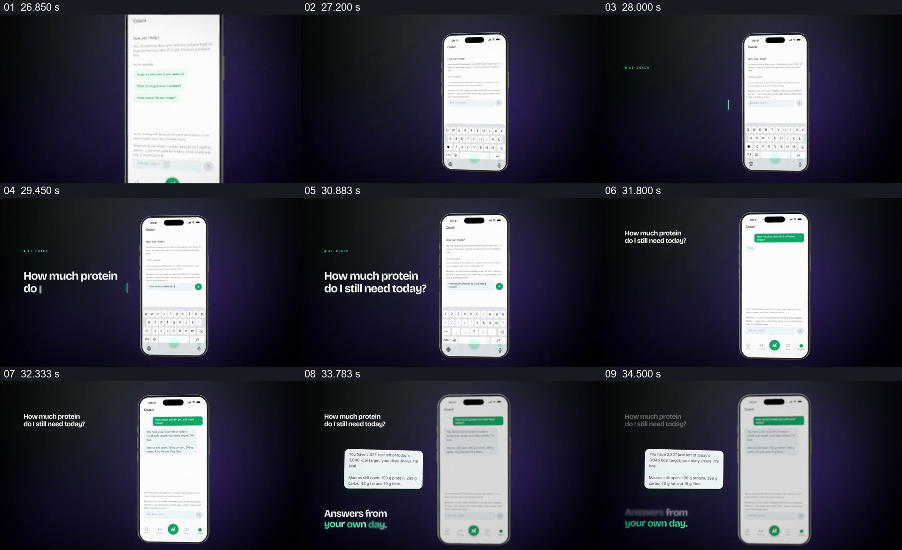

# 把屏内问题和回答依次提出，让问答与当天数据相连

- 作品：案例 043《食物图片与健康应用》（库内索引名）。
- 原片范围：00:26.800–00:35.000，含起点、不含终点；[完整原片](../video.mp4)｜[本卡片段](c05-20261111.mp4)，片段起点对应原片 26.800 秒。
- 范围依据：从教练问答界面建立、问题输入到回答浮卡及来源提示；35 秒后多部手机进入整片功能汇总。
- 观察方式：核看全片 64 帧总览及本卡九宫格，并核看各交界附近每 0.2 秒源帧；未独立连续原速观看，快速变化和运动节奏待核。原片无音轨。片中事实和演示未独立查证，新题材迁移尚未实测。

## 原画面具体怎样设计

画面由绿色训练页转为带紫色光晕的深色背景，手机显示教练聊天与输入键盘。手机左侧先出现问题 “How much protein do I still need today?”；手机输入区也出现相同问题，随后问题进入聊天记录。

屏内显示一段含当天摄入及剩余项目数字的答复；手机稍微退弱后，答复被提成外侧白色卡片，左下出现 “Answers from your own day.”。这让问题、回答与手机的原始聊天页面同时可辨；随后多部手机一起进入，转向整片功能总结。片中答案及其所声称的数据来源未经独立验证。

## 为什么这样设计，好在哪里

先把问题放大到设备外，观众先知道要解决什么，再看手机中的对应输入；回答出现后同样外提，能在小屏之外看清主要内容，而设备仍作为出处。短句强调答案与当天记录的关系，使问答不只是孤立的聊天演示。若问题与答复无法对应，或者没有能支持答复的数据背景，外提卡也只是一段看似可信的文字。以上是基于画面的分析，不代表回复医学准确或用户已受益。

## 可直接使用的创意指令

要展示基于上下文的问答时，选取一个与现有真实记录有直接关系的问题和可核对的回答。先在界面中建立输入，同时让问题在外部可读；回答出现后保留原聊天页面，将关键回复和必要的数据范围或来源一起放到读者看得清的位置。问题、回答和来源须能互相对应；聊天样式、外提方向、色彩可以调整。若数据缺失或回答不能得到验证，应显示不确定性，不把示例中的营养数值当成个体建议。
