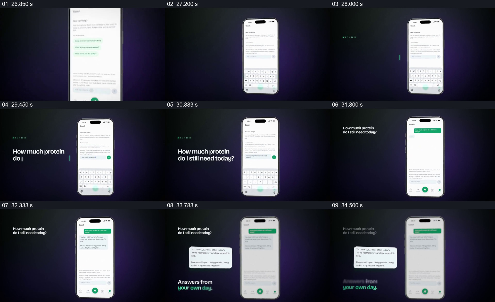

# 把屏内问题和回答依次提出，让问答与当天数据相连

- 作品：案例 043《食物图片与健康应用》（库内索引名）。
- 原片范围：00:26.800–00:35.000，含起点、不含终点；[完整原片](../video.mp4)｜[本卡片段](c05-20261111.mp4)，片段起点对应原片 26.800 秒。
- 范围依据：从教练问答界面建立、问题输入到回答浮卡及来源提示；35 秒后多部手机进入整片功能汇总。
- 观察方式：核看全片 64 帧总览及本卡九宫格，并核看各交界附近每 0.2 秒源帧；未独立连续原速观看，快速变化和运动节奏待核。原片无音轨。片中事实和演示未独立查证，新题材迁移尚未实测。

## 原画面具体怎样设计

画面由绿色训练页转为带紫色光晕的深色背景，手机显示教练聊天与输入键盘。手机左侧先出现问题 “How much protein do I still need today?”；手机输入区也出现相同问题，随后问题进入聊天记录。

屏内显示一段含当天摄入及剩余项目数字的答复；手机稍微退弱后，答复被提成外侧白色卡片，左下出现 “Answers from your own day.”。这让问题、回答与手机的原始聊天页面同时可辨；随后多部手机一起进入，转向整片功能总结。片中答案及其所声称的数据来源未经独立验证。

## 为什么这样设计，好在哪里

先把问题放大到设备外，观众先知道要解决什么，再看手机中的对应输入；回答出现后同样外提，能在小屏之外看清主要内容，而设备仍作为出处。短句强调答案与当天记录的关系，使问答不只是孤立的聊天演示。若问题与答复无法对应，或者没有能支持答复的数据背景，外提卡也只是一段看似可信的文字。以上是基于画面的分析，不代表回复医学准确或用户已受益。

## 完整照排指令

以[完整原片](../video.mp4)的 26.8–35 秒为准。画幅 1280×720，源帧率 60/1。以下拍点为抽帧定位，位置按画幅百分比取近似值。

### 用料

【当天记录】【输入问题】【同日回答】【来源短注】须属于同一日与同一对象，问题涉及的指标、单位和答案口径可回查。备【问答手机页】【答复浮卡】【结尾页面组】【结尾标题】；使用授权记录并遮去无关私人字段。

### 按源时刻摆放

1. **26.800–约 29.000 秒。** 近黑的青紫渐变底，白底竖手机居中略偏右，内置【问答手机页】，下部保留浅灰键盘。左侧逐词建立白粗【输入问题】，末态两行左齐，字区与手机留缝。左边复述必须和框内发出的原话相同。
2. **约 29.000–31.800 秒。** 提问提交后保留手机外框，键盘退去，绿色短状态在手机顶部，回答继而在屏内出现。左侧问题收小并移高。以同一【同日回答】生成白色【答复浮卡】，从手机内原行附近向左提出，允许短时间遮住手机左缘，正文黑灰小字分行。手机原回答及外框继续留到浮卡到位。
3. **约 31.800–33.500 秒。** 浮卡与右手机同屏，左下另立白绿两行【来源短注】，说明答案取自【当天记录】。静页可按同一截图分层，但不重复生成或以别天记录填充。浮卡自露面到组合切出持续保留。
4. **约 33.500–35.000 秒。** 深底转绿，单机拉回，其旁相继列出竖向【结尾页面组】，原问答页在其中留作对照。上方细白【结尾标题】居中。群组留到 35 秒按索引切出。

### 局部采用

仅有问题和可回溯当天数据时可用 26.800–约 33.500 秒，切在多机版接管前。

### 验证状态

已对照每秒两帧原片画序并读回，核对左问句、同框回答、提出后附当天来源及多机切出。精确切帧、回答原文及换料试摆待核。
