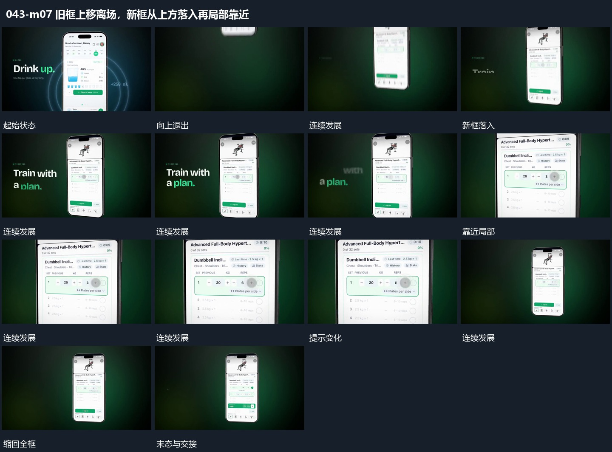

# 旧框上移离场，新框从上方落入再局部靠近

## 运动指令

让旧竖框向上离开，新框从画面上方进入并落到一侧。新框稳定后靠近其中一处，局部提示变化，再缩回完整尺度。后面的横条外提与回收继续使用来源保持的关系，不需重建外框。

## 视频切片

[播放本机制的原片切片](m07.mp4)

保留起始准备、连续发展和完成或明确交接；首尾按本段运动范围裁切，不拼接、不变速。尾部只保留理解结果所需的展示。

## 分镜过程

## 组合与调整

可替换新框内容，不能把旧框与新框声称为同一对象变形。接点主要是方向与位置；纵向通道需避免同时挤入两个完整框。
