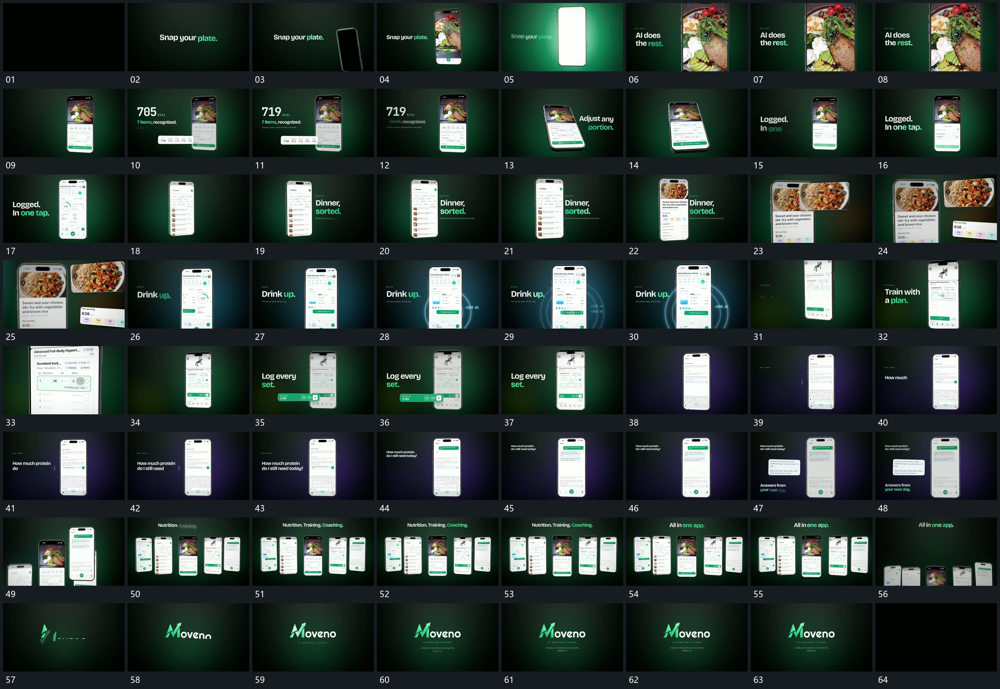

# 043｜原片运动总览

[观看完整原片](video.mp4)

## 运动总览

先逐词建立短句，再用 倾斜竖框从下方升入，转正后推近 让倾斜竖框升入、转正并推近。框内局部提示变化后，底部面板上推覆盖，整框缩回后内条向外伸出 从底部推出面板，缩回全框并将内条向外延展，伴随数字增长；强调完成后收回。

随后 同一竖框横移转向，左右文字交替让位 使同一框横移转向，两侧字组交替建立。框内有一次向下移出旧内容，再转入 边界固定，内部列表滚动后被侧入面板接替 的列表上行与侧板覆盖。框内局部提成外侧浮片，强调后回收 从新内容中提取上片和下条到框外，原内部保留。换组后 局部圆环接连扩散，数字与内部填充同步增加 用连续扩散圈带出数字上浮与内部累计。

接着 旧框上移离场，新框从上方落入再局部靠近 让旧框上退、新框落入并完成局部靠近。内条外提和回收再次复用 框内局部提成外侧浮片，强调后回收。下一次内容换入后，外侧文字逐字建立，再缩移为框内短条 建立外侧文字，再缩移交给框内短条；框内内容继续增加，其中一段又用 框内局部提成外侧浮片，强调后回收 提成外侧浮卡并回收。

末段 多个竖框错峰升入并缩排成列，再整列退出 把多个竖框升入、缩排成横列，上方字组补入，保持后整列向下退出。字形从底部遮挡线分段升出，副行随后接入 从底部遮挡线升出主字形与附属行，最后整体减淡。原片多次复用外提与回收；子机制切片保留一个连续代表范围，其余出现位置仍可在完整原片中查看。

## 完整运动段落

以下按原片中的出现顺序引用。建立、内部发展及完成反馈放在同一段中；同时发生的局部动作与运镜写在同一份指令里。不同段之间可以是连续接管，也可以是直接切换，不能仅凭条目相邻认定可直接拼接。重复出现的同类运动采用一次连续代表范围，切片不以逐段无缝覆盖整片为目标。

1. [倾斜竖框从下方升入，转正后推近](mechanisms/m01.md)：先让外框可辨认，再推近内部，侧字随阶段更换。

2. [底部面板上推覆盖，整框缩回后内条向外伸出](mechanisms/m02.md)：面板先覆盖内部下部，缩回建立全框，再从内条原位置向外扩展。

3. [同一竖框横移转向，左右文字交替让位](mechanisms/m03.md)：竖框持续留场，横移和转动腾出文字区，旧字先退新字后接。

4. [边界固定，内部列表滚动后被侧入面板接替](mechanisms/m04.md)：外框不随内部滚动，侧入面板覆盖旧列表并成为新承载层。

5. [框内上下两片依次外提，来源退弱而浮片留下](mechanisms/m05.md)：外框先保持，以上方图块原位置为起点建立前层副本，移向右上；下方横条随后向右下提出，两片错开停在外框旁。来源内容仍保留，外框逐渐退弱，外侧两片成为重点；本切片保留强调结果，到换场前结束。

6. [局部圆环接连扩散，数字与内部填充同步增加](mechanisms/m06.md)：重复反馈围绕同一局部发生，外框不动，结果留在内部。

7. [旧框上移离场，新框从上方落入再局部靠近](mechanisms/m07.md)：旧组先让出位置，新组沿同一竖向通道接上，保持可辨认的接力。

8. [外侧文字逐字建立，再缩移为框内短条](mechanisms/m08.md)：先在外侧完整建立，再用缩移与框内承接保持内容对应。

9. [多个竖框错峰升入并缩排成列，再整列退出](mechanisms/m09.md)：各框从不同高度进入并缩到共同尺度，中间主框略大，退出时作为整组。

10. [字形从底部遮挡线分段升出，副行随后接入](mechanisms/m10.md)：下沿限制可见范围，各段向上越过同一边界，再建立附属行。

切片保留起始准备、必要内部停顿和完成或明确交接；首尾省略无新发展的等待，持续运动不要求人为停住。以上基于真实源帧序列和重点边界核对，不等同于全片连续声画审片。

## 完整64宫格

