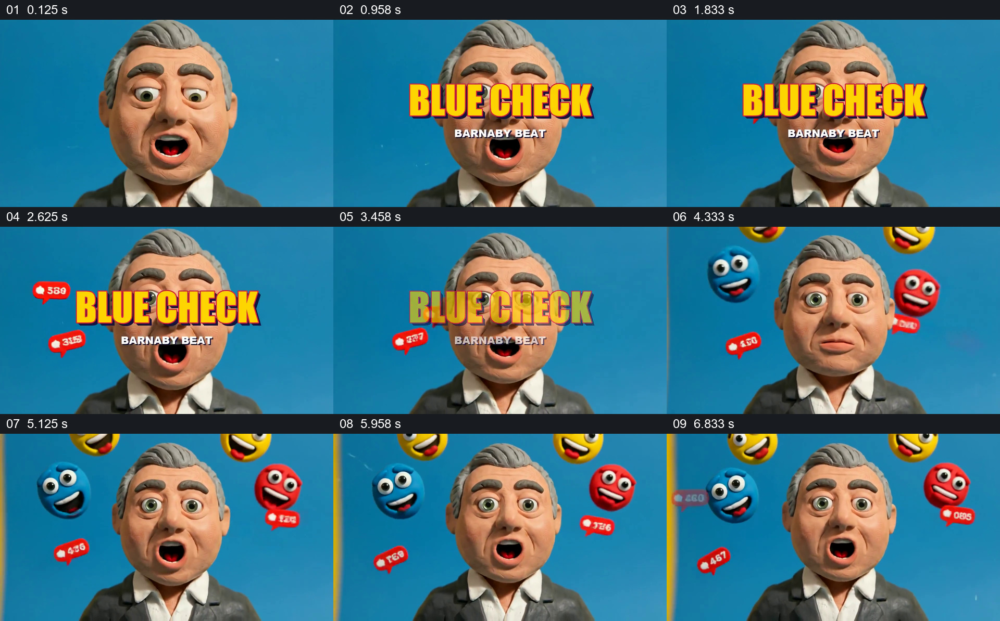

# 标题压在人物面前，再让社交反应包围他

- 作品：案例 008《三维角色、图形与舞台》（索引名称）。
- 原片范围：00:00.000–00:07.500，含起点、不含终点；[完整原片](../video.mp4)｜[本卡片段](c01.mp4)。
- 观察方式：依据整片 64 宫格、约每秒源帧及交接处加密抽帧；未连续原速观看或听审，声音内容与具体表演节奏未确认。

## 原画面具体怎样设计

蓝色背景上，灰发西服人物以大近景面对镜头。黄色“BLUE CHECK”和较小的“BARNABY BEAT”叠在人脸前；红色数字气泡从周边出现。标题消失后，人物仍占据中央，黄色、蓝色和红色表情球从头部周围露出，红色数字气泡分布在两侧。直到换景前，这些外围元素与人物同框。

## 为什么这样设计，好在哪里

标题先占据人脸前方，作品和角色迅速成为同一开场；标题退去后，表情和小气泡在保留人物的位置上补出周围环境。观众可以同时看清人物表情和围绕他的反应，不必用一连串独立图标画面说明。数字是造型，不能据此推断真实互动量。

以上为依据画面的分析，非作者自述；预期观看效果未经观众测试。

## 可直接使用的创意指令

当开场需要让观众先认识一个持续出现的角色，同时感受到围绕他的反馈环境时，用近景稳定角色位置，把节目名称短暂放在前景；名称退出后，保留角色面部的可读空间，让少量不同表情或反馈符号分布在头部两侧及后方，并保持角色反应可见。选用与内容相符的符号和经过核实的数据；如果数字只是装饰，明确按虚构设计处理。后续切到更宽场景时继续保留该角色，使观众认出是同一主体。
