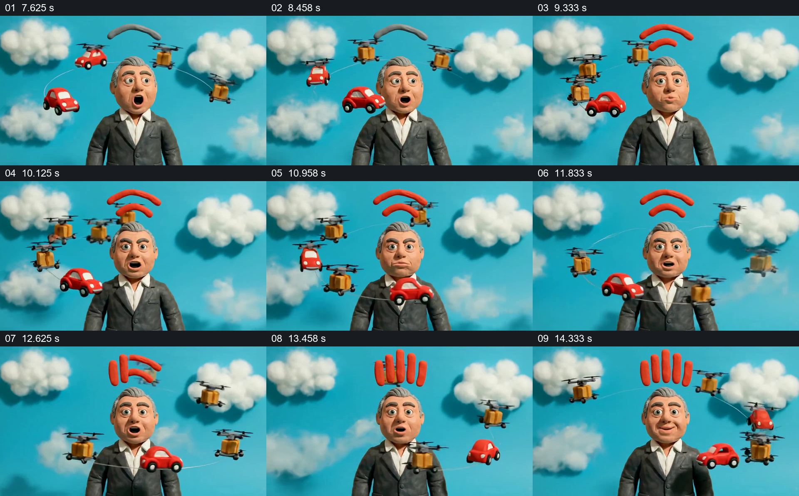

# 人物留在中央，让交通与信号在周围运行

- 作品：案例 008《三维角色、图形与舞台》（索引名称）。
- 原片范围：00:07.500–00:15.000，含起点、不含终点；[完整原片](../video.mp4)｜[本卡片段](c02.mp4)。
- 观察方式：依据整片 64 宫格、约每秒源帧及交接处加密抽帧；未连续原速观看或听审，声音内容与具体表演节奏未确认。

## 原画面具体怎样设计

画面由近景转到更远的位置，人物仍在中央；青蓝空间里有多团白云、红色小汽车及提着箱子的无人机。汽车和无人机出现在人物前后及左右不同高度，头顶先有弧形符号，随后变成红色信号形状和竖向短条。人物保持面对观众，周围对象在同一画面中改变位置。

## 为什么这样设计，好在哪里

云朵和不同高度的交通物件把抽象的技术符号放进具体空间；人物稳定在中心，使外围位置的变化容易比较。头顶信号提供另一条清晰的视觉线索，但这些玩偶并不能证明某种交通或通信机制。

以上为依据画面的分析，非作者自述；预期观看效果未经观众测试。

## 可直接使用的创意指令

当内容要表现一个人处于多种并行活动或服务之间，先建立可持续辨认的中心主体，再选择少量有不同职责的环境物件，安排它们从前后和高低不同的位置经过，保留主体脸部或操作位置。用主体附近的一处简洁符号表示当前状态变化，变化应能被读懂；若解释真实系统，另配经过核实的说明，不让示意物件承担事实证明。对象样式、行进方向及画幅随新内容调整。
