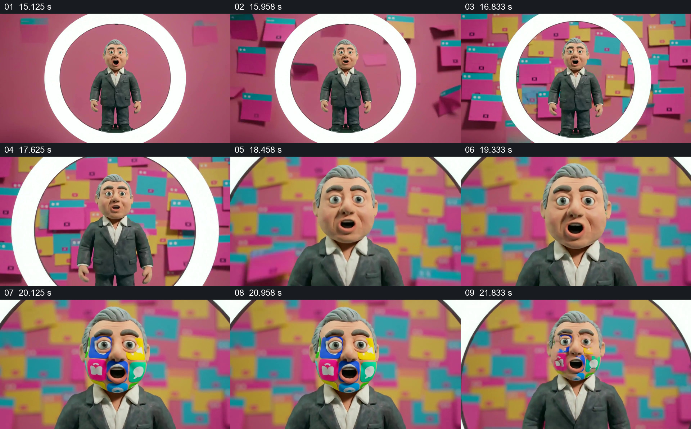

# 窗口铺满背景，再把应用图标叠到角色脸上

- 作品：案例 008《三维角色、图形与舞台》（索引名称）。
- 原片范围：00:15.000–00:22.500，含起点、不含终点；[完整原片](../video.mp4)｜[本卡片段](c03.mp4)。
- 观察方式：依据整片 64 宫格、约每秒源帧及交接处加密抽帧；未连续原速观看或听审，声音内容与具体表演节奏未确认。

## 原画面具体怎样设计

粉色场中，白色圆环框住全身人物，后方彩色小窗口不断增多。人物在圆内由远变近，窗口铺满背景，白环边缘扩大到画外；彩色应用图标随后排列在人物脸部，包括眼周、嘴部和面颊，之后逐渐退去，重新露出原脸。

## 为什么这样设计，好在哪里

背景窗口的积累先让观众感到信息密集，图标进入脸部则把相同的界面语言推到主体身上。人物始终可辨，覆盖与恢复形成清楚的前后差别；圆框从包围主体变成大视野的边缘，把尺度变化连成一次观察。

以上为依据画面的分析，非作者自述；预期观看效果未经观众测试。

## 可直接使用的创意指令

当素材中已有一个可识别的角色，并希望让信息环境从背景影响到人物本身时，先在框内呈现完整人物，让多个不同但同类的界面窗口在背后逐渐建立；再推进观察尺度，使背景充满画面，把少量可识别的图标短暂覆盖在人物局部，最后保留图标退去或主体恢复的结果。图标需要与内容确有关系，覆盖时留出表情或其他主体识别线索；真实界面、数据与示意图分开标明。
