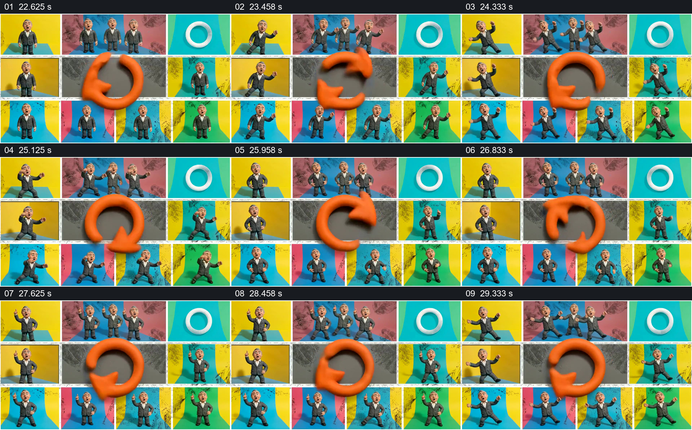

# 把同一角色拆成多格表演，中央循环箭头贯穿

- 作品：案例 008《三维角色、图形与舞台》（索引名称）。
- 原片范围：00:22.500–00:30.000，含起点、不含终点；[完整原片](../video.mp4)｜[本卡片段](c04.mp4)。
- 观察方式：依据整片 64 宫格、约每秒源帧及交接处加密抽帧；未连续原速观看或听审，声音内容与具体表演节奏未确认。

## 原画面具体怎样设计

画面切为白边分隔的多格：多数格子里是同一西服人物，在黄色、蓝色、粉色和绿色背景前做不同姿态，右上另有白色圆环。中间较大的灰色格放着橙色环形箭头；人物动作和箭头方向在后续抽帧中持续变化，布局总体保持到换景。

## 为什么这样设计，好在哪里

把多个版本放在同屏，使差异与重复同时可见；中央较大的箭头在密集人像中提供统一焦点。每格不必承担独立叙事，它们共同构成一次重复表演，适合表现形式节奏，而非证明真实流程循环。

以上为依据画面的分析，非作者自述；预期观看效果未经观众测试。

## 可直接使用的创意指令

当材料包含同一角色的多种可并列状态，且目标是让观众体验重复或并行，而不是阅读复杂信息时，将各状态排成稳定网格，让不同格的姿态或动作形成变化；在中央或其他显眼区域放置与内容有关的循环符号，让它与网格持续共存。保持每格主体足够辨认，控制重复时长并留出下一场的交接。真实循环关系须由内容另行说明，符号本身只承担视觉提示。
