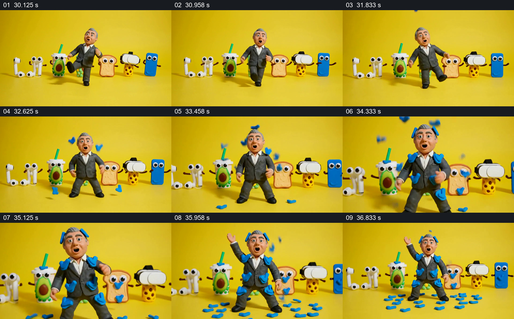

# 拟人道具排成队列，让蓝色标记落到人物身上

- 作品：案例 008《三维角色、图形与舞台》（索引名称）。
- 原片范围：00:30.000–00:37.500，含起点、不含终点；[完整原片](../video.mp4)｜[本卡片段](c05.mp4)。
- 观察方式：依据整片 64 宫格、约每秒源帧及交接处加密抽帧；未连续原速观看或听审，声音内容与具体表演节奏未确认。

## 原画面具体怎样设计

黄色背景和地面上，人物居中走动；后排依次可见拟人化耳机、饮品、面包、头显和手机等物件。蓝色小片从上方出现，逐渐落在人物的头、肩、衣服和腿上，也散落在脚下。人物继续活动，后方道具队列维持整体布局，最后满身和地面都留有蓝色片块。

## 为什么这样设计，好在哪里

后排物件形成一眼可辨的角色集合，主角在前景保持主次。蓝色片块有逐渐积累的结果，观众可以从干净的衣服看到变化，而不是只收到一个突然出现的状态；它们的具体含义仍需依赖完整作品。

以上为依据画面的分析，非作者自述；预期观看效果未经观众测试。

## 可直接使用的创意指令

当内容适合用拟人化对象陪伴一个主角，并有一个能视觉化的标记需要逐渐累积时，让相关物件保持可辨的横向队列，主角位于前景并留出身体轮廓；让标记从画外进入、逐步落在主体及地面，保留此前落下的部分，直到形成可见的新状态。物件只选与新主题有关系的类别，标记的意义通过上下文建立；身体覆盖程度和舞台形式按阅读及表演需要调整。
