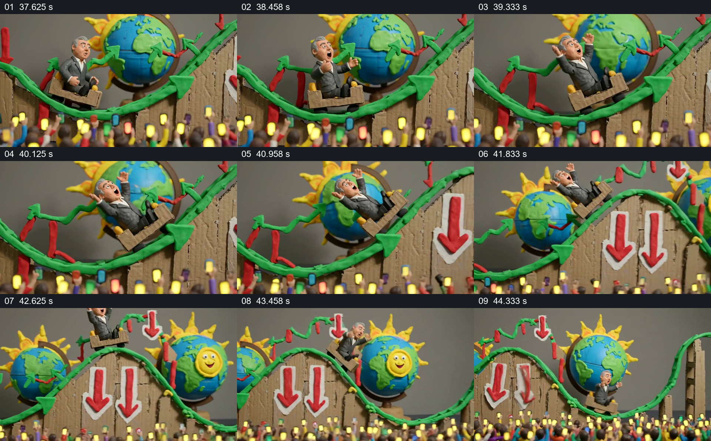

# 让人物坐上曲线轨道，把起伏变成可见行程

- 作品：案例 008《三维角色、图形与舞台》（索引名称）。
- 原片范围：00:37.500–00:45.000，含起点、不含终点；[完整原片](../video.mp4)｜[本卡片段](c06.mp4)。
- 观察方式：依据整片 64 宫格、约每秒源帧及交接处加密抽帧；未连续原速观看或听审，声音内容与具体表演节奏未确认。

## 原画面具体怎样设计

人物坐在纸板质感的小车里，沿绿色起伏轨道穿过画面。后方有地球和太阳造型，轨道结构上挂着向下的红箭头，画面下缘挤满举着彩色亮屏的观众。视野由较近的小车与地球扩展到多段连续弯曲的轨道；人物随着小车的位置呈现上行、下行和不同姿态。

## 为什么这样设计，好在哪里

曲线不只作为背景图表，而成为人物身体所处的路线；轨道上下的空间变化让过程更容易被感知。拉远后仍能看见同一小车和更多弯段，把局部经历放回整体，观众和箭头则补足舞台语境。画面中的箭头并非真实数据。

以上为依据画面的分析，非作者自述；预期观看效果未经观众测试。

## 可直接使用的创意指令

当主题需要让观众感受一个主体经历反复起伏，而非精确读取数值时，先给主体一个能沿路径移动的载体，在近景建立一段曲线和周边环境；随后扩大视野，保留同一载体，让更多上升、下降和转折段出现，并使主体姿态与路径位置相互对应。可以用少量环境符号补充语境；若路线代表实际数据，应使用真实尺度和来源，示意轨道不能替代数据图。
