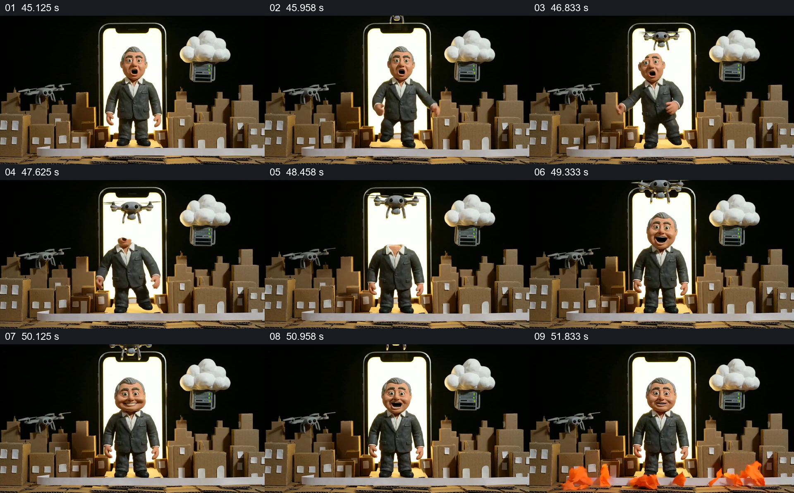

# 手机与纸板城市同框，头部越出后恢复

- 作品：案例 008《三维角色、图形与舞台》（索引名称）。
- 原片范围：00:45.000–00:52.500，含起点、不含终点；[完整原片](../video.mp4)｜[本卡片段](c07.mp4)。
- 观察方式：依据整片 64 宫格、约每秒源帧及交接处加密抽帧；未连续原速观看或听审，声音内容与具体表演节奏未确认。

## 原画面具体怎样设计

黑色背景前是一座纸板城市，发光的竖向手机屏位于中央，人物站在屏幕前；两侧可见无人机以及云下的设备。人物头部靠近屏幕上方的无人机，随后身体一度呈现没有头部或只露头部局部的状态，再恢复完整面孔。城市和手机整体位置保持，末段前景出现橙色火焰造型。

## 为什么这样设计，好在哪里

不变的手机框与纸板城市让人物头部的异常变化成为容易辨认的事件；恢复完整人像后出现的火焰，又改变同一空间的气氛。由抽帧无法确认每一瞬间的运动路径，也不能把这个玩偶画面解释为真实事件。

以上为依据画面的分析，非作者自述；预期观看效果未经观众测试。

## 可直接使用的创意指令

当想在已建立的屏幕场景中制造一次可辨认的身体或物体变化时，先保持屏幕边框和周围环境稳定，安排主体与屏幕上缘或前景物件接近；让局部短暂越出、遮挡或消失，再恢复可识别状态。若后面还需改变气氛，可在相同空间加入能被辨认的环境变化，然后再交接新场景。根据实际素材选择可实现的遮挡方式；变化的意义和因果需要新内容提供。
