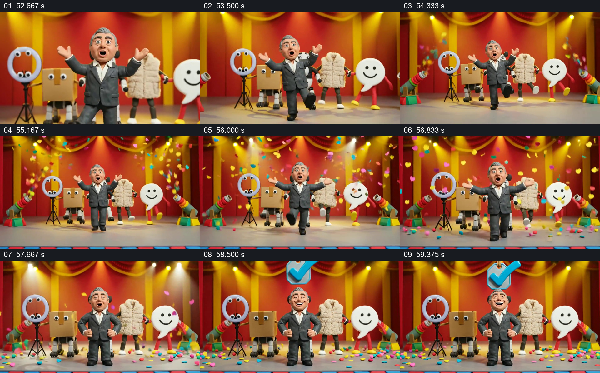

# 角色与拟人道具汇到舞台，勾号完成集体定格

- 作品：案例 008《三维角色、图形与舞台》（索引名称）。
- 原片范围：00:52.500–01:00.053，含起点、不含终点；[完整原片](../video.mp4)｜[本卡片段](c08.mp4)。
- 观察方式：依据整片 64 宫格、约每秒源帧及交接处加密抽帧；未连续原速观看或听审，声音内容与具体表演节奏未确认。

## 原画面具体怎样设计

红金色幕布和灯光构成舞台，人物在中央前景伸臂并变换姿态；后方并排有圆环、箱子、衣物和笑脸气泡等拟人道具。舞台两侧出现礼炮造型，彩色纸片从上方落下并堆在地面。人物最后回到居中姿态，蓝色勾号从头顶出现，角色、道具和落下的纸片共同留在最终画面。

## 为什么这样设计，好在哪里

前景人物与后排伙伴的固定层次使汇合容易辨认；从舞台建立到彩纸散落、标记出现，结尾有明确的视觉累积。最后的勾号呼应全片标题中的视觉元素，给观众一个可辨的收束；这只是作品内的形式关系，不等于某个账号已获认证。

以上为依据画面的分析，非作者自述；预期观看效果未经观众测试。

## 可直接使用的创意指令

当结尾要把同一作品中已建立的主体与相关对象聚合时，为主角保留前景位置，把伙伴或关键物件排在后方，先让观众认清组合，再加入可持续留在现场的庆祝元素。最后放入全片反复出现、含义已建立的标记，并保留主体与整个队列同框，让结尾可被读完。具体场景、角色数量和标记随主题调整；认证、成绩或身份等事实须另有依据。
