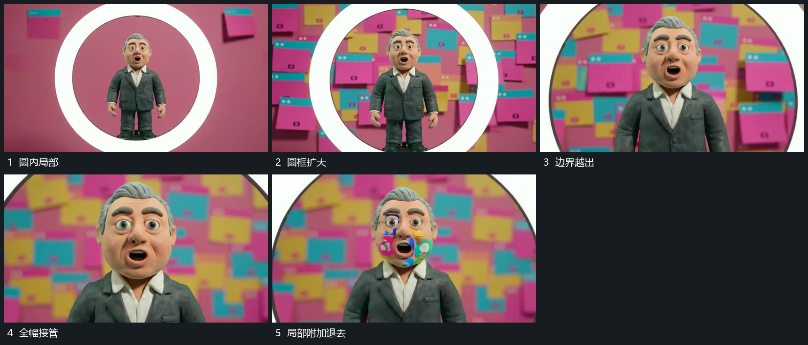

# 圆框内局部放大，圆边越出后新底层铺满

## 运动指令

先在圆框中保持中心活动，逐渐推近内部，使圆边扩大到画外。新底层铺满后局部附加小块短暂叠入又退出，中心活动保留。

## 视频切片

[播放本机制的原片切片](m03.mp4)

覆盖分镜中“圆内局部”至“局部附加退去”的连续过程，并保留邻近的前后衔接画面；原片中交叠发生的动作一并保留。

## 分镜过程

## 组合与调整

圆内内容必须在放大前可辨认；附加小块可省略，不把圆边退去写成硬切。
