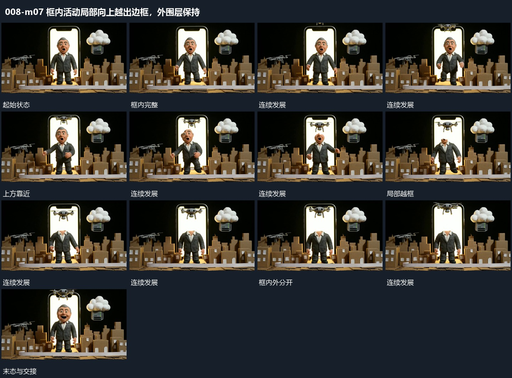

# 框内活动局部向上越出边框，外围层保持

## 运动指令

保持竖框与旁层，让活动轮廓的一部分向上接近边缘，再越出框外，其余部分仍在内部。外框不随局部抬升，局部返回时恢复原先的完整关系。

## 视频切片

[播放本机制的原片切片](m07.mp4)

保留起始准备、连续发展和完成或明确交接；首尾按本段运动范围裁切，不拼接、不变速。尾部只保留理解结果所需的展示。

## 分镜过程

## 组合与调整

越框需要独立层与遮挡，不能只扩大整个竖框；新片可改为侧向越出。
