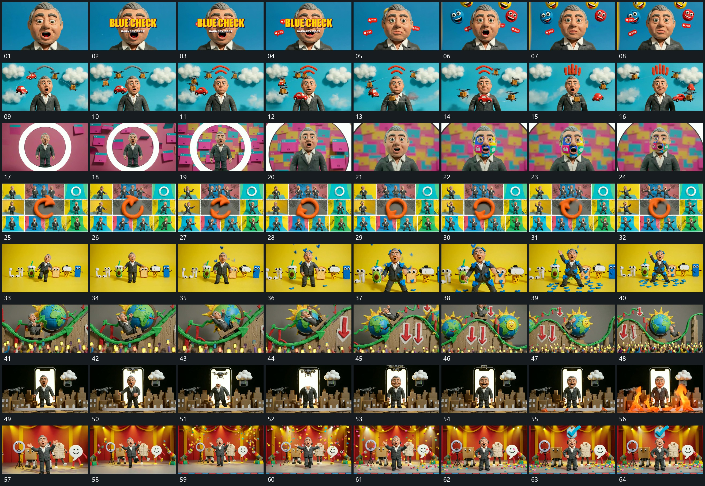

# 008｜原片运动总览

[观看完整原片](video.mp4)

## 运动总览

开头中心活动轮廓留场，中心活动保持，前方字与外围小片错开进入 在其前后错开建立字组和外围小片。换入较远尺度后，拉远露出外围层，中心保持而周边横向经过 让中心活动继续、外围层横向经过，并在上方更新短形。接 圆框内局部放大，圆边越出后新底层铺满 从圆形框住的局部推近，圆边越出后由新底层接管。

随后 多格活动片留场，中央环形持续自转 用多格活动片形成满幅集合，中央环形自转。换入独立全幅后 小片从上方分批落下，在底部散开保留 从上方分批落下小片，中心活动与两侧排布保持。后段 活动体沿波形通道上行下行，范围拉远露更多弯段 让活动体沿波形通道行进，观察范围拉远，更多弯段显出。

再进入竖框内外并置，框内活动局部向上越出边框，外围层保持 局部上移越框并变换前景遮挡，外围仍保持；之后直接换入下一活动场面。尾段分散小片继续下落，上方标记接入，整组停在完成布局。字组入场、外围经过和小片散落在不同段落复用。

## 完整运动段落

以下按原片中的出现顺序引用。建立、内部发展及完成反馈放在同一段中；同时发生的局部动作与运镜写在同一份指令里。不同段之间可以是连续接管，也可以是直接切换，不能仅凭条目相邻认定可直接拼接。重复出现的同类运动采用一次连续代表范围，切片不以逐段无缝覆盖整片为目标。

1. [中心活动保持，前方字与外围小片错开进入](mechanisms/m01.md)：附加层先后建立，中心不停止

2. [拉远露出外围层，中心保持而周边横向经过](mechanisms/m02.md)：中心继续，外围移动体现空间变化

3. [圆框内局部放大，圆边越出后新底层铺满](mechanisms/m03.md)：圆内范围放大，内容先可见再接管

4. [多格活动片留场，中央环形持续自转](mechanisms/m04.md)：背景网格稳定，环的运动独立于各格

5. [小片从上方分批落下，在底部散开保留](mechanisms/m05.md)：先到的落地留住，后批继续下降

6. [活动体沿波形通道上行下行，范围拉远露更多弯段](mechanisms/m06.md)：路径高度改变带动活动体，拉远保留同一通道

7. [框内活动局部向上越出边框，外围层保持](mechanisms/m07.md)：局部运动越框，外框和旁层不跟随

切片保留起始准备、必要内部停顿和完成或明确交接；首尾省略无新发展的等待，持续运动不要求人为停住。以上基于真实源帧序列和重点边界核对，不等同于全片连续声画审片。

## 完整64宫格

