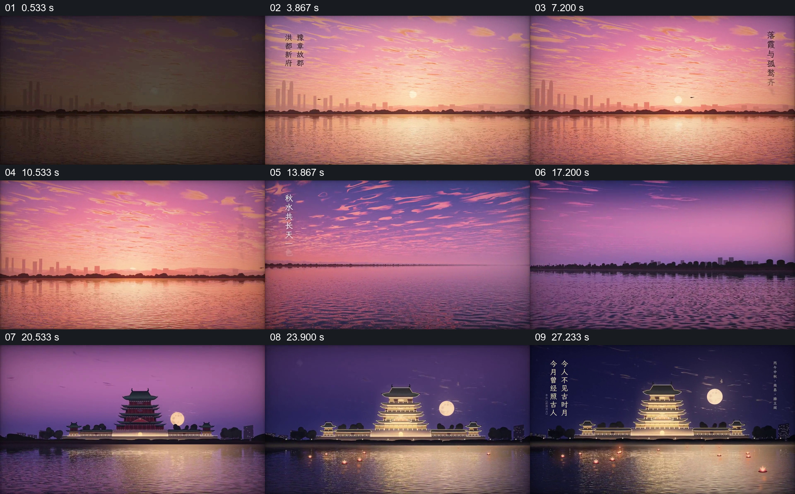

# 让同一水岸从日落过渡到夜间建筑与月亮

- 作品：案例 103《水面日落到夜景》（本次概括）。
- 原片范围：00:00.000–00:30.046，含起点、不含终点；[完整原片](../video.mp4)｜[本卡片段](../video.mp4)。
- 观察方式：依据约每秒一次的真实源帧观察，未连续原速观看或听审；声音、语气与完整播放节奏未确认。

## 原画面具体怎样设计

宽阔水面上方是城市天际线和落日，竖排文字出现在天空边缘；画面沿水岸移动，天空由橙粉转为紫色，远岸轮廓保持。楼阁进入画面并逐渐亮灯，月亮在旁边升起，水面出现灯光倒影，竖排文字继续出现。

## 为什么这样设计，好在哪里

水面和远岸提供持续的空间参照，天空色彩、建筑灯光与倒影共同提示时间变化；文字贴着景物边缘，不夺走远景主体。文字出处与实景真实性未核验。

以上为依据画面的分析，非作者自述；预期观看效果未经观众测试。

## 可直接使用的创意指令

展示同一地点的时间变化时，选择可持续辨认的地平线或水岸，逐步改变天空、建筑光源及其倒影，保留同一空间位置作为对照；引用诗文或现实景物时核对出处，画面可用实景或明确标示的再现。
