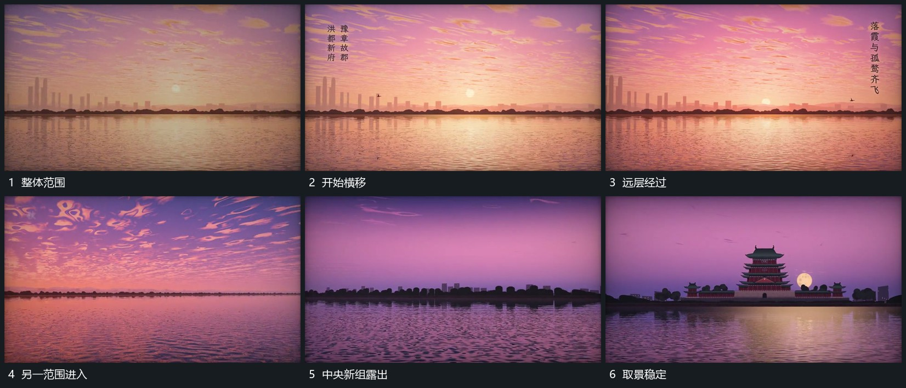

# 沿水平基准缓慢横移远近层连续经过

## 运动指令

沿同一水平基准缓慢横移，远层位移较小，前层细条与小形经过幅度略大。新的中央组从边缘进入时逐步收小横移，让其在主要范围稳定；水平基准始终留在相近高度，不随每段重新摆放。

## 视频切片

[播放本机制的原片切片](m01.mp4)

覆盖分镜中“整体范围”至“取景稳定”的连续过程，并保留邻近的前后衔接画面；原片中交叠发生的动作一并保留。

## 分镜过程

## 组合与调整

可用于任何长空间，避免过多上下漂移；近远层移动差异保持轻微。
