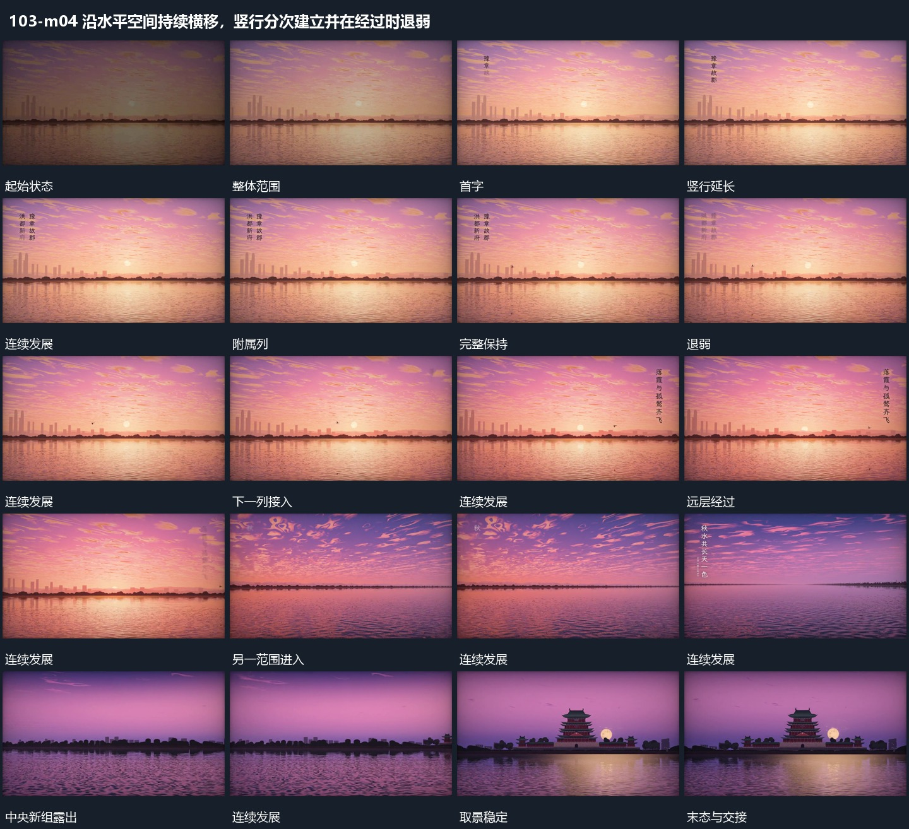

# 沿水平空间持续横移，竖行分次建立并在经过时退弱

## 运动指令

起始：远近层和水平基准已在。

1. 远近层沿同一横移方向连续经过，近层经过更快。

2. 竖行在局部出现时逐字补齐，停留后退弱，让后续区域接替。

上述镜头变化与局部动作按同一条连续过程推进；写明同时发生的步骤在原场面中交叠，不先完成整段运镜再重演局部。

## 视频切片

[播放本机制的原片切片](m04.mp4)

保留起始准备、连续发展和完成或明确交接；首尾按本段运动范围裁切，不拼接、不变速。相连的小动作合为同一完整段落。

## 分镜过程

## 组合与调整

保留以下动作关系：远近层沿同一横移方向连续经过，近层经过更快；竖行在局部出现时逐字补齐，停留后退弱，让后续区域接替。

可调整位移距离、层级间距、重复数量与相对快慢；已有锚点和未退出的层继续承接。连接下一段时以切片末态为起点，另行设计不连续的状态转换。
