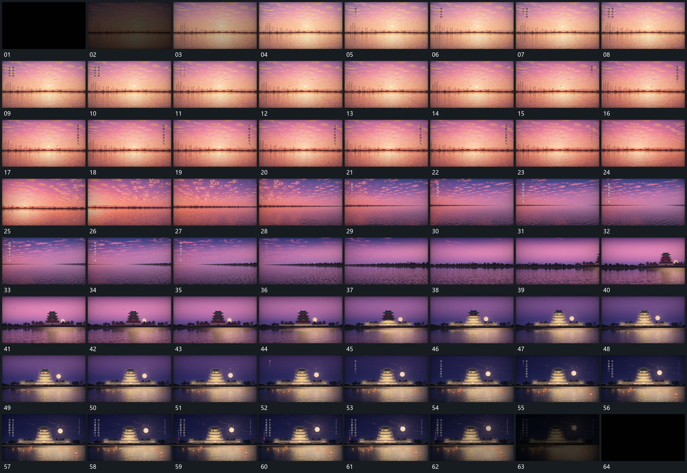

# 103｜原片运动总览

[观看完整原片](video.mp4)

## 运动总览

全片沿同一水平基准持续展开，沿水平基准缓慢横移远近层连续经过缓慢横移，远近层以不同幅度经过。其间多次复用竖向短行逐字增加保持后退弱接下一列，让竖向短行逐字建立、保持再退去；下方细线与小形继续局部运动。

取景转到新的中央组后收小横移，下方小片分次加入并缓慢横向经过让下方小片分次加入并缓慢经过，已有后层保持。结尾继续复用竖向短行逐字增加保持后退弱接下一列建立双竖行，整体退弱结束。

## 完整运动段落

以下按原片中的出现顺序引用。建立、内部发展及完成反馈放在同一段中；同时发生的局部动作与运镜写在同一份指令里。不同段之间可以是连续接管，也可以是直接切换，不能仅凭条目相邻认定可直接拼接。重复出现的同类运动采用一次连续代表范围，切片不以逐段无缝覆盖整片为目标。

1. [沿水平空间持续横移，竖行分次建立并在经过时退弱](mechanisms/m04.md)：远近层沿同一横移方向连续经过，近层经过更快；竖行在局部出现时逐字补齐，停留后退弱，让后续区域接替。

2. [下方小片分次加入并缓慢横向经过](mechanisms/m03.md)：分次建立缓慢移动

切片保留起始准备、必要内部停顿和完成或明确交接；首尾省略无新发展的等待，持续运动不要求人为停住。以上基于真实源帧序列和重点边界核对，不等同于全片连续声画审片。

## 完整64宫格

