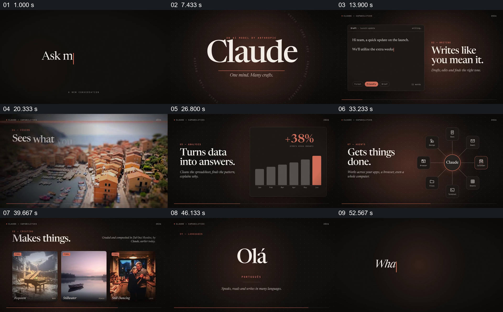

# 用统一版式把不同能力各自接到可辨认的示例

- 作品：案例 107《品牌能力巡览与港湾影像标注》（库内索引名称）。
- 原片范围：00:00.000–00:58.048，含起点、不含终点；[完整原片](../video.mp4)｜[本卡片段](../video.mp4)。
- 范围依据：从提问与品牌建立，到各能力示例、多语言、总结和品牌淡出；保留整片。港湾局部另见 c02。
- 观察方式与未确认范围：查看整片 64 帧总览和本卡分镜。未独立完成连续原速观看与听审；抽帧之间的运动、停顿与声音配合待复核。画面中的界面、数字与说明是作品呈现，未经额外核实；设计价值为基于画面的分析。

## 原画面具体怎样设计

黑棕色背景中央先显示逐步成形的“Ask me anything”，随后白色衬线品牌字出现，橙色细线和很小的类别标记建立视觉体系。每个能力段沿用深色背景、白色短标题、橙色编号与底部细线，但具体材料改变：思考段有问题和分支，写作段把文本窗口放在标题旁，代码段同时呈现代码窗口与任务清单。

视觉段以港湾影像铺满背景，左上文字和图中橙色对象标记共同出现；数据段把表格变成柱形图并突出 +38%，检索段有来源卡，执行段以中心节点连接应用图标，创作段并列三张成品图。随后动词和多语言问候在统一文字舞台上轮换，最后出现三条价值表述、提问和品牌。

各段通过相同的编号、字体、颜色和底部细线保持整体身份，具体页面则根据不同内容采用窗口、影像、图表或卡片。

## 为什么这样设计，好在哪里

固定版式让观众迅速识别每个新主题，同时让每项能力拥有不同的具体对象，而不只是不断切换形容词。例子从写作到图像、数据和产物各自保持可读；末尾再以简短语言汇总，既保留广度，也把具体示例收回同一品牌。

各界面、图像识别和 +38% 均为影片演示，未核实实际功能或数据；抽帧不足以确认每段动画节奏及声音关系。

## 可直接使用的创意指令

先列出观众需要理解的少数能力，为每项准备一个真实、可辨认的输入和结果。确定稳定的标题位置、编号、字体与色彩，再根据内容选择文本、照片、图表或具体产物；完成巡览后用简短的共同主张收束。

不必复制深色和品牌风格；应让每个例子真实支持对应主张，不用展示界面冒充功能或把示例数字当作统计事实。

本方法尚未在新题材中实测。
