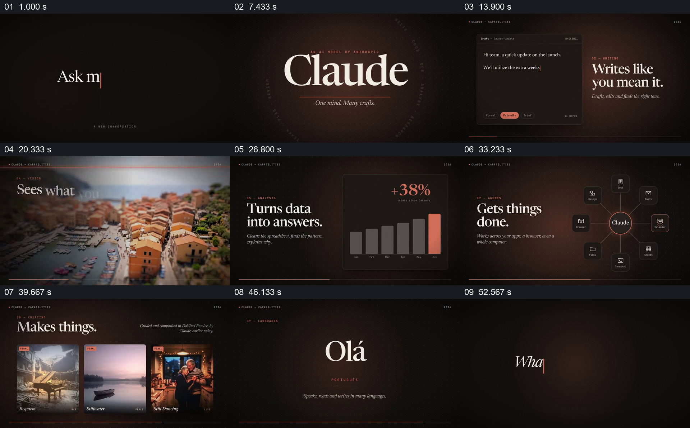

# 用统一版式把不同能力各自接到可辨认的示例

- 作品：案例 107《品牌能力巡览与港湾影像标注》（库内索引名称）。
- 原片范围：00:00.000–00:58.048，含起点、不含终点；[完整原片](../video.mp4)｜[本卡片段](../video.mp4)。
- 范围依据：从提问与品牌建立，到各能力示例、多语言、总结和品牌淡出；保留整片。港湾局部另见 c02。
- 观察方式与未确认范围：查看整片 64 帧总览和本卡分镜。未独立完成连续原速观看与听审；抽帧之间的运动、停顿与声音配合待复核。画面中的界面、数字与说明是作品呈现，未经额外核实；设计价值为基于画面的分析。

## 原画面具体怎样设计

黑棕色背景中央先显示逐步成形的“Ask me anything”，随后白色衬线品牌字出现，橙色细线和很小的类别标记建立视觉体系。每个能力段沿用深色背景、白色短标题、橙色编号与底部细线，但具体材料改变：思考段有问题和分支，写作段把文本窗口放在标题旁，代码段同时呈现代码窗口与任务清单。

视觉段以港湾影像铺满背景，左上文字和图中橙色对象标记共同出现；数据段把表格变成柱形图并突出 +38%，检索段有来源卡，执行段以中心节点连接应用图标，创作段并列三张成品图。随后动词和多语言问候在统一文字舞台上轮换，最后出现三条价值表述、提问和品牌。

各段通过相同的编号、字体、颜色和底部细线保持整体身份，具体页面则根据不同内容采用窗口、影像、图表或卡片。

## 为什么这样设计，好在哪里

固定版式让观众迅速识别每个新主题，同时让每项能力拥有不同的具体对象，而不只是不断切换形容词。例子从写作到图像、数据和产物各自保持可读；末尾再以简短语言汇总，既保留广度，也把具体示例收回同一品牌。

各界面、图像识别和 +38% 均为影片演示，未核实实际功能或数据；抽帧不足以确认每段动画节奏及声音关系。

## 完整照排指令

以[完整原片](../video.mp4)的 0–58.048 秒为准。画幅 1280×720，源帧率 30/1。以下拍点为抽帧定位，位置按画幅百分比取近似值。

### 源时刻照排

- 0–约 7 秒，黑棕渐晕底，中间以白色衬线字逐步输入【开场提问】，保留细光标。提问退后，放大居中【品牌字标】，底下细橙线稳定短留。
- 约 7–20 秒，按思考、写作、编程三拍换【能力标题】，白色衬线大字、较小【能力说明】与边缘橙色【能力序号】贯穿。思考拍左字右放【问题分支】，写作拍将【写作窗口】移到文案另一侧，编程拍上下组织标题与并排【代码窗口】【任务清单】。暗棕窗留细边，正文字号按各材料读时设置。
- 20–24 秒，【场景影像】全幅接管，左上背景渐暗，白色标题与短说明在前。依次给影像对象叠橙色【视觉标记】，右下摘要留到切出。
- 约 24–44 秒，回暗棕底，依次在标题旁置【数据表图】【检索来源卡】【执行关系图】与【创作样例】。数据从表格交棒到柱图和橙色【变化数字】；检索卡可读出处；关系图以中心橙点连外围节点；创作样例同高并排，均留统一细线与小编号。
- 约 44–58.048 秒，内容窗退给居中白色衬线【轮换动词】、【多语问候】与橙色小注，之后换【价值句】和【收尾提问】，最后【品牌字标】回到中央，至片尾。

### 用料与取用

【开场提问】【品牌字标】【能力标题】【能力说明】【能力序号】【轮换动词】【多语问候】【价值句】【收尾提问】供定稿短文和正确译法。各标题与【问题分支】【写作窗口】【代码窗口】【任务清单】【场景影像】【视觉标记】【数据表图】【变化数字】【检索来源卡】【执行关系图】【创作样例】逐项配对。代码和任务须对应同一次工作，图表和数值须同表同口径，检索卡须可定位到链接、标题及引用原句，产品能力有版本和可核对出处。各主窗自本拍建立至下一能力接管；有真实操作时提供覆盖该拍的录屏且不循环，静态应用截图仅用于静止结果，变化必须有分层或真实操作。【场景影像】20–24 秒同画面留存，固定照片允许静置，移动影像须保持标注跟踪。仅有一项能力可独立取其对应拍，例如 20–24 秒的图像识别，删去连续序号和与缺席能力相关的结语。

### 验证状态

已对照原片等距抽帧与卡稿，核查共享排印、能力材料切换、满幅例外和品牌回归。各短拍精确切点、原速听看及实际换料待核。
