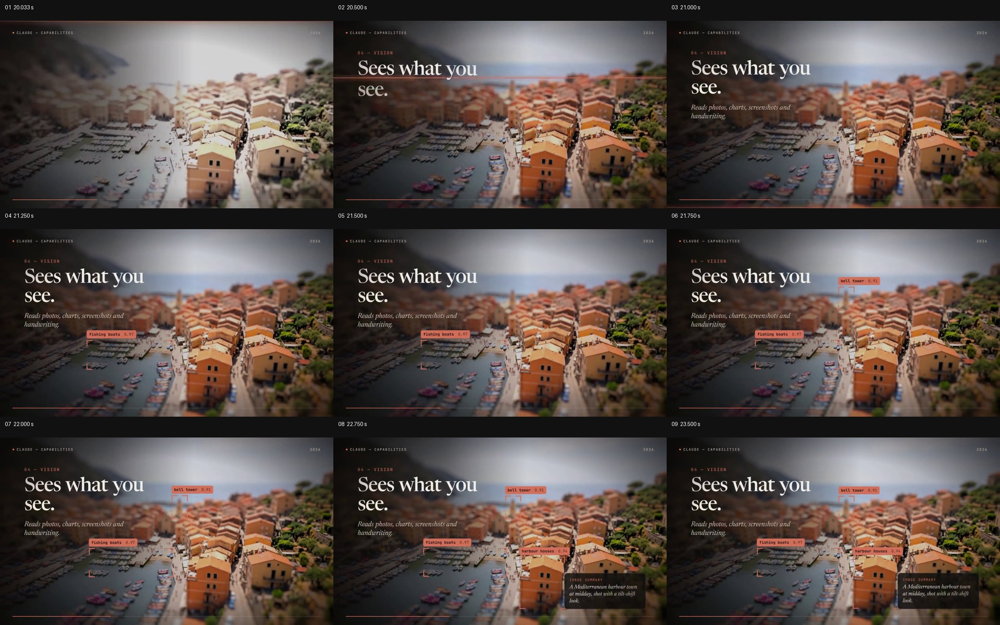

# 让港湾影像先被看见，再把对象标记和整体摘要叠在原位置

- 作品：案例 107《品牌能力巡览与港湾影像标注》（库内索引名称）。
- 原片范围：00:20.000–00:24.000，含起点、不含终点；[完整原片](../video.mp4)｜[本卡片段](c02-20261111.mp4)。
- 范围依据：从港湾图像成为背景，到三个局部标记与整体摘要同屏；24 秒后切入数据段。本范围包含在 c01 中。
- 观察方式与未确认范围：查看整片 64 帧总览和本卡分镜。未独立完成连续原速观看与听审；抽帧之间的运动、停顿与声音配合待复核。画面中的界面、数字与说明是作品呈现，未经额外核实；设计价值为基于画面的分析。

## 原画面具体怎样设计

一张俯看港湾的图像接管画面：水面和渔船位于左下，橙色屋顶集中在右侧，远处是天空与海。左侧区域被压暗，白色标题“Sees what you see”及较小的说明叠在图上，照片仍完整可辨。

橙色短标签及角形边框先出现在水面船只周围，随后在上方钟楼和右侧房屋区域出现另外两组标记；每个标签带对象名称与小数。最后右下角加一张深色摘要卡，总结这幅港湾影像，先前的图像、标题和各个局部标记仍同时可见。

## 为什么这样设计，好在哪里

先呈现整幅图，观众有机会自行理解场景；标签分别落在对应局部，说明关注点在哪里，而不是把名称挪到与影像脱节的清单。多个局部保留到摘要出现，使观看从船、塔和房屋回到整个港湾，局部和整体处于同一幅画面。左侧压暗为文字争取对比度，右侧仍让影像承担主要视觉信息。

标签及小数为影片中的演示标记，本次未验证目标检测、识别置信度或照片实际地点。

## 完整照排指令

以[完整原片](../video.mp4)的 20–24 秒为准。画幅 1280×720，源帧率 30/1。以下拍点为抽帧定位，位置按画幅百分比取近似值。

### 源时刻照排

- 20–约 21 秒，全幅【港湾底图】接管暗场，左下水面密集放船、右侧是浅墙和瓦顶，地平线靠上。左侧加暗色渐变，叠两行白色衬线【识别标题】，小号无衬线【识别说明】在其下。
- 约 21–23 秒，先在靠左下的【对象区域】画橙色角框及细底条【对象标签】，再于上方钟楼和右侧房屋各建一处。标签内以小黑字放【对象名称】及【标签小数】，始终贴在实际区域附近，先出标记持续可见。
- 约 23–24 秒，右下深棕边框卡叠【场景摘要】，白字短行排印且避开对象框，左上标题、所有标记和完整照片同时保留。24 秒切给数据段。

### 用料与取用

【港湾底图】可换同样具三个空间分离目标的可授权单图，须给水面、地标、建筑等实际【对象区域】与可辨位置坐标。【对象标签】【对象名称】【标签小数】【场景摘要】应依据同一图像的实际识别结果，交模型版本、实际输出及小数含义，人工示例明示，外部事实附可核对来源。【识别标题】【识别说明】需能落进左侧暗区的短排印。底图 20–24 秒持续，允许静帧或轻微同画运镜，若交原视频须足长、不循环，标注要跟踪，不允许顿住运动画面来伪造识别稳定性。只有单一结果可用约 20–22 秒的底图到首个标记，省去没有支撑的其余标签和综合摘要。

### 验证状态

已对照原片约 0.27 秒间隔抽帧与卡稿，核查三处标记的建立、前标记持续、摘要进场和图片同屏。细字释义、精确切出、原速听看与实际换料待核。
