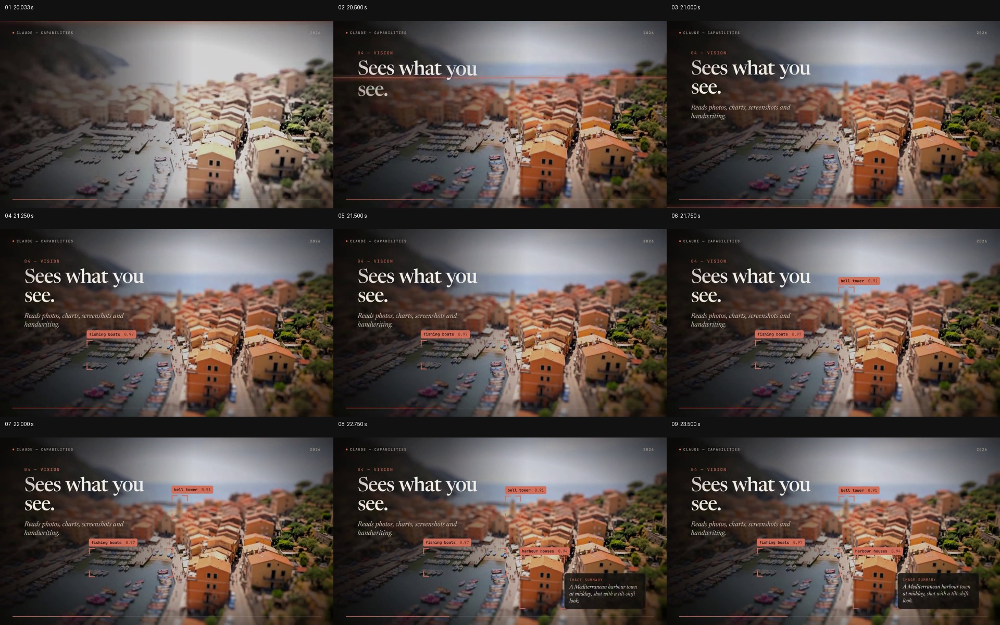

# 让港湾影像先被看见，再把对象标记和整体摘要叠在原位置

- 作品：案例 107《品牌能力巡览与港湾影像标注》（库内索引名称）。
- 原片范围：00:20.000–00:24.000，含起点、不含终点；[完整原片](../video.mp4)｜[本卡片段](c02-20261111.mp4)。
- 范围依据：从港湾图像成为背景，到三个局部标记与整体摘要同屏；24 秒后切入数据段。本范围包含在 c01 中。
- 观察方式与未确认范围：查看整片 64 帧总览和本卡分镜。未独立完成连续原速观看与听审；抽帧之间的运动、停顿与声音配合待复核。画面中的界面、数字与说明是作品呈现，未经额外核实；设计价值为基于画面的分析。

## 原画面具体怎样设计

一张俯看港湾的图像接管画面：水面和渔船位于左下，橙色屋顶集中在右侧，远处是天空与海。左侧区域被压暗，白色标题“Sees what you see”及较小的说明叠在图上，照片仍完整可辨。

橙色短标签及角形边框先出现在水面船只周围，随后在上方钟楼和右侧房屋区域出现另外两组标记；每个标签带对象名称与小数。最后右下角加一张深色摘要卡，总结这幅港湾影像，先前的图像、标题和各个局部标记仍同时可见。

## 为什么这样设计，好在哪里

先呈现整幅图，观众有机会自行理解场景；标签分别落在对应局部，说明关注点在哪里，而不是把名称挪到与影像脱节的清单。多个局部保留到摘要出现，使观看从船、塔和房屋回到整个港湾，局部和整体处于同一幅画面。左侧压暗为文字争取对比度，右侧仍让影像承担主要视觉信息。

标签及小数为影片中的演示标记，本次未验证目标检测、识别置信度或照片实际地点。

## 可直接使用的创意指令

选一张有多个清楚目标的真实图像，先完整建立场景；在不遮盖主体的位置逐项标注需要说明的对象，用短名称和指向性边框与图中位置对应。保留已标注对象，再用一条有依据的文字概括整体环境，让观众能从局部回到全图。

可用于设备照片、地图或显微图；标注颜色和位置可以变化，但对象及数值需核实，不能用虚构置信度冒充实际识别结果。

本方法尚未在新题材中实测。
