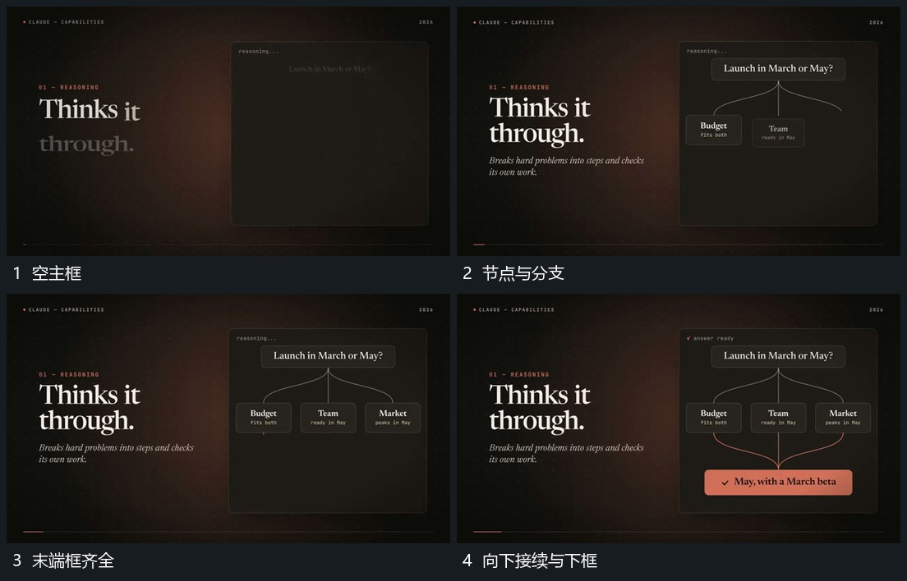

# 上方节点分出连接末端框接入再汇到下框

## 运动指令

先建立上方节点，从其下缘逐条延长分支到左右不同落点。末端框在连接接近时依次接入，已有分支保持；再从末端方向向下延长连接，共同接到下方宽框，宽框最后展开并保持。

## 视频切片

[播放本机制的原片切片](m02.mp4)

覆盖分镜中“空主框”至“向下接续与下框”的连续过程，并保留邻近的前后衔接画面；原片中交叠发生的动作一并保留。

## 分镜过程

## 组合与调整

分支数量按需要决定；连接从实际节点派生，不能先出现完整网再补节点。
