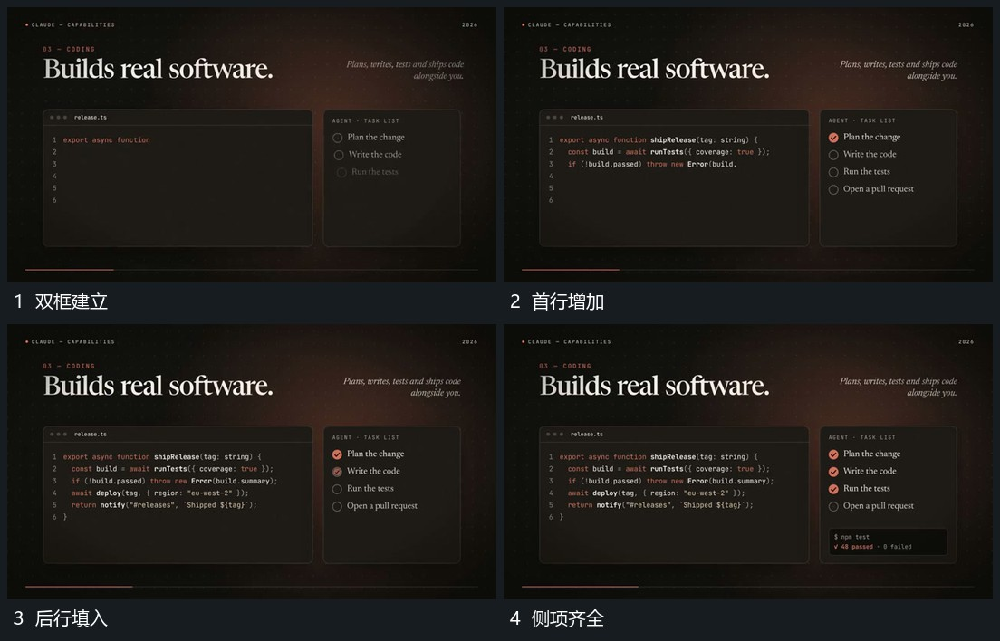

# 双框保持一侧逐行填入另一侧逐项补标记

## 运动指令

保留两框相对位置，一侧字行从上向下逐行填入，已有行不移动。另一侧短项先建立，完成标记随后逐个接入，主侧仍继续补字；末尾小条在底部接上，两框共同保持。

## 视频切片

[播放本机制的原片切片](m03.mp4)

覆盖分镜中“双框建立”至“侧项齐全”的连续过程，并保留邻近的前后衔接画面；原片中交叠发生的动作一并保留。

## 分镜过程

## 组合与调整

可替换输入内容，不要求原功能含义；两侧进度有错开，避免同时整框闪现。
